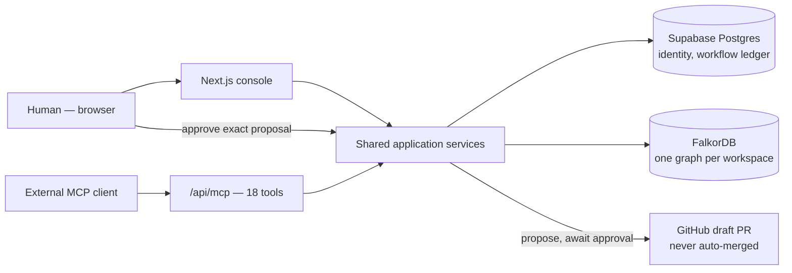

# Waypoint

<div align="center">
  
  <br /><br />
  <strong>An action-first agent for connected operational data — graph reasoning your team can actually trust, with a human in the loop on every action.</strong>
  <br /><br />
  
  
  
  
  <br /><br />
  <a href="#quick-start">Quick start</a> ·
  <a href="video/dist/waypoint-demo.mp4">Demo video</a> ·
  <a href="docs/DOCUMENTATION_INDEX.md">Documentation</a> ·
  <a href="docs/Product/IMPACT_AND_EVIDENCE.md">Evidence</a> ·
  <a href="IMPLEMENTATION_TRACKER.md">Implementation tracker</a>
</div>

Waypoint is a graph the agent actually walks, not a chatbot with a vector index bolted on.
**FalkorDB is the graph store the product reasons on** — `resolve_entity` and
`trace_entity` are real, bounded `GRAPH.QUERY` calls, not a display layer over some other
database. Every answer is cited back to an authorized tool result, and the agent abstains
instead of guessing when evidence is thin. Agents can *propose* a GitHub patch or a
deployment rollback; nothing ever executes without a human approving the exact proposal,
and GitHub changes land only as **draft pull requests, never auto-merged**.

Submitted for **GraphHacks** — primary track **Agents That Act on Connected Data**, with
supporting tracks **Company Brain** and **Agent Memory and Coordination**. Built with
AI-assisted development (Claude Code), disclosed per the hackathon's rule 11 — see
[`video/youtube.md`](video/youtube.md).

## Demo

<div align="center">
  <a href="video/dist/waypoint-demo.mp4">
    
  </a>
  <br />
  <sub>The first ~75 seconds are a live screen recording against the running app (2026-10-18) — real sign-in, a real connected GitHub repo, a real FalkorDB graph, a real agent trace. Two live runs hit a provider rate limit mid-recording, and that failure is shown rather than cut around. The graph-model and approval→draft-PR scenes are clearly labeled illustrative, not footage — see <a href="video/README.md">video/README.md</a> for exactly what's real vs. illustrated and why.</sub>
</div>

### Product walkthrough

| Real GitHub repository, actually connected | The agent traces the graph live |
|---|---|
|  |  |

| Every claim is cited, or it abstains | A durable, inspectable investigation |
|---|---|
|  |  |

| Tasks and handoffs, leased not clobbered | Proposals require human approval |
|---|---|
|  |  |

All six are real screenshots from the 2026-10-18 verification session — not mockups.

## What is real and what is in progress

| Part | Status |
|---|---|
| Graph reads (`resolve_entity`, `trace_entity`), MCP endpoint (18 tools), citation-validated agent loop, Supabase auth/workspaces, GitHub source sync | **Real, verified live** on 2026-10-18 — see [Impact and evidence](docs/Product/IMPACT_AND_EVIDENCE.md). |
| FalkorDB | **Real locally, via Docker** (the configured Cloud endpoint has been unreachable since 2026-10-15 — see `IMPLEMENTATION_TRACKER.md` M1.2). Local `GRAPH.QUERY` round-trips are real, not mocked. |
| Draft-PR execution for an approved proposal | Implemented, offline-contract-tested, **not yet exercised in a live successful run**. The agent-initiated write path currently 502s — a real, open bug, not hidden. See [System architecture](docs/Architecture/SYSTEM_ARCHITECTURE.md#known-gap-in-this-path-as-of-2026-10-18). |
| Fraud investigation / security triage workflow packs | Same infrastructure, **no connected source provider yet** — genuinely open scope, not a demo gap. |
| Offline contract tests | 27 scripts, all passing (`bun run test:contracts`); `typecheck` clean. These prove internal consistency, not live behavior. |

Full honesty discipline and acceptance gates live in
[`IMPLEMENTATION_TRACKER.md`](IMPLEMENTATION_TRACKER.md) — status legend: `todo` /
`in_progress` / `blocked` / `done`, and `done` requires recorded evidence, not just code
existing.

## Documentation

| Area | Documentation |
|---|---|
| API | [Every REST route and all 18 MCP tools](docs/API/API_REFERENCE.md) |
| Architecture | [System diagram, agent-run and approval sequences, trust boundaries](docs/Architecture/SYSTEM_ARCHITECTURE.md) |
| Graph model | [What's in FalkorDB today, the real traversal Cypher](docs/Architecture/GRAPH_MODEL.md) |
| Backend | [Module map, the agent loop's invariants](docs/Backend/BACKEND_GUIDE.md) |
| Database | [Supabase schema, migrations, idempotency](docs/Database/DATABASE_DESIGN.md) |
| Decisions | [Short-form ADRs — why the system is shaped this way](docs/Decisions/DECISIONS.md) |
| Deployment | [Local setup, managed services, env vars](docs/Deployment/DEPLOYMENT_GUIDE.md) |
| Development | [Pre-PR checks, conventions, gotchas](docs/Development/DEVELOPMENT_GUIDE.md) |
| Frontend | [Routes, the Cockpit, component sources](docs/Frontend/FRONTEND_GUIDE.md) |
| Operations | [Credentials, deletion, recovery, incident response](docs/Operations/OPERATIONS_GUIDE.md) |
| Product | [Pain points and proof contract, user journey](docs/Product/PRODUCT_PLAN.md) |

Full index: [docs/DOCUMENTATION_INDEX.md](docs/DOCUMENTATION_INDEX.md).

## Quick start

```bash
git clone https://github.com/AVENGERSTHE2102/BroCode.git waypoint && cd waypoint
bun install
cp .env.example .env     # fill in Supabase + GitHub App + model provider values

# FalkorDB: local Docker, no account needed (the Cloud endpoint is currently unreachable)
docker run -d --name falkordb -p 16379:6379 -p 3002:3000 \
  -v falkordb_data:/data falkordb/falkordb:latest
# FALKORDB_URL=falkor://localhost:16379

bun run dev
```

Offline checks (no secrets needed, should always pass on a clean checkout):

```bash
bun run typecheck
bun run test:contracts
```

Full first-run runbook — including exactly what each `.env` value unlocks, and the four
evidence levels used throughout this repo — is in [`TESTING.md`](TESTING.md). It's written
to be followed literally by a human or an AI coding agent.

## How Waypoint works



Every answer is a path through connected evidence, not a retrieved snippet: the agent
calls `resolve_entity` to pin down exactly what you're asking about, then `trace_entity`
for a bounded multi-hop `GRAPH.QUERY` traversal, and the UI lights up the actual graph
path it walked. See [the full sequence diagrams](docs/Architecture/SYSTEM_ARCHITECTURE.md)
for the agent-run loop and the approval-to-draft-PR flow.

## Built with

| Tool | Role in Waypoint |
|---|---|
| FalkorDB | The reasoning graph — not a display layer. One graph per workspace, server-derived names, role-scoped ACLs enforced inside every Cypher query. |
| Model Context Protocol (official TypeScript SDK) | `/api/mcp` publishes 18 tools and 3 domain prompts; `bun run test:mcp-sdk` connects the real client library and discovers them. |
| Supabase (Auth + Postgres) | Identity, RLS-scoped workspace membership, and the authoritative transactional store for investigations, facts, tasks, and approvals. |
| GitHub App | Least-privilege source connection and scoped, short-lived, single-use draft-PR execution tokens. |
| Any OpenAI-compatible model provider | Built and evaluated against Groq's free tier (`openai/gpt-oss-20b`); switching providers is a 3-env-var change. |
| Claude Code | Used to build this project and to produce the submission video — disclosed per hackathon rule 11. |

Other tools: Next.js, TypeScript, Tailwind, shadcn/ui, Remotion (video production). No
other sponsor integrations.

## Repository map

```text
Brocode_GraphHacks/
├── src/
│   ├── app/              # Next.js routes: cockpit, investigations, API routes, MCP endpoint
│   ├── components/       # Cockpit, graph canvas/explorer, landing page, shared UI
│   └── lib/               # Graph tools, agent runner, action proposals, facts/attempts/tasks, GitHub App
├── supabase/migrations/  # 23 ordered SQL migrations — see docs/Database
├── scripts/              # Offline contract checks (bun run test:contracts), eval harness, diagnostics
├── eval/                 # Synthetic + LoCoMo-derived evaluation fixtures
├── docs/
│   ├── API/               # REST + MCP contract reference
│   ├── Architecture/       # System diagram, graph model, sequence diagrams
│   ├── Backend/            # Module map, agent-loop invariants
│   ├── Database/           # Supabase schema and migration design
│   ├── Decisions/          # Short-form architecture decision records
│   ├── Deployment/         # Local + managed-service setup
│   ├── Development/        # Pre-PR checks, conventions, gotchas
│   ├── Frontend/           # Routes, components, design notes
│   ├── Operations/         # Credentials, deletion, recovery, incident response
│   ├── Product/            # Plan, evidence, research archive, eval results
│   └── assets/screenshots/ # Real screenshots used in this README
├── video/                 # Remotion project + the rendered demo video (video/dist/)
├── IMPLEMENTATION_TRACKER.md  # Authoritative milestone/evidence log
├── TESTING.md                 # Runbook for a clean checkout (humans and AI agents)
└── AGENTS.md                  # Repository instructions for coding agents
```

## Contributors

<table align="center">
  <tr>
    <td align="center" width="33%">
      <a href="https://github.com/DeepMehta06">
        <br />
        <strong>DeepMehta06</strong>
      </a>
    </td>
    <td align="center" width="33%">
      <a href="https://github.com/AVENGERSTHE2102">
        <br />
        <strong>AVENGERSTHE2102</strong>
      </a>
    </td>
    <td align="center" width="33%">
      <a href="https://github.com/devikabongarde">
        <br />
        <strong>devikabongarde</strong>
      </a>
    </td>
  </tr>
</table>

## What this is not

- Not a verified production system — see the honesty gates in
  [`IMPLEMENTATION_TRACKER.md`](IMPLEMENTATION_TRACKER.md) before relying on any
  capability marked `in_progress` or `blocked`.
- Not evidence that "graph retrieval beats flat context" — the comparison eval harness is
  real and its numbers are real, but it hasn't yet produced a stronger-model-robust result
  either way. See [`docs/Product/eval-results/README.md`](docs/Product/eval-results/README.md).
- Not a claim that any action has executed against a real GitHub repository through the
  agent's own write path — see the open bug noted above.
