<div align="center">

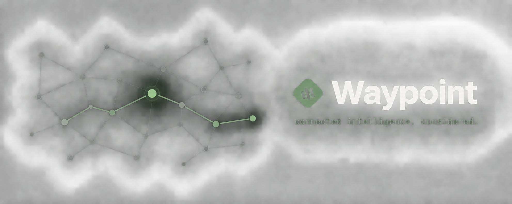

# Waypoint

### Graph-grounded agents that show their work — and ask before they act.

<br />

<a href="https://waypoint-one-mu.vercel.app">
  
</a>
&nbsp;
<a href="https://youtu.be/lO6gwdgbC2M">
  
</a>
&nbsp;
<a href="https://medium.com/@devikabongarde/your-ai-agent-sounds-confident-can-it-prove-it-172e6e0a29a8">
  
</a>

<br /><br />


<br />


<br /><br />

<a href="#try-it-live"><b>Live app</b></a> ·
<a href="https://youtu.be/lO6gwdgbC2M"><b>Demo video</b></a> ·
<a href="https://medium.com/@devikabongarde/your-ai-agent-sounds-confident-can-it-prove-it-172e6e0a29a8"><b>Blog</b></a> ·
<a href="#the-knowledge-graph"><b>Graph</b></a> ·
<a href="#how-it-works"><b>Architecture</b></a> ·
<a href="#quick-start"><b>Quick start</b></a> ·
<a href="docs/DOCUMENTATION_INDEX.md"><b>Docs</b></a> ·
<a href="docs/Product/IMPACT_AND_EVIDENCE.md"><b>Evidence</b></a>

</div>

<br />

> [!TIP]
> **Most AI agents guess. Waypoint shows its work.**
> Every answer is a walk through a real knowledge graph — cited, path-highlighted, and
> traceable back to the source commit or file. Every action waits for a human to approve
> *that exact change*.

<br />

## The problem → the Waypoint answer

<table>
<tr>
<th width="50%">Typical AI agent</th>
<th width="50%">Waypoint</th>
</tr>
<tr>
<td>Stitches together similarity-search fragments</td>
<td>Traverses a <b>FalkorDB knowledge graph</b> with bounded multi-hop <code>GRAPH.QUERY</code> calls</td>
</tr>
<tr>
<td>Confident answers you can't verify</td>
<td>Every claim <b>cited</b>, the <b>exact graph path</b> highlighted, explicit <b>uncertainty</b> where evidence stops</td>
</tr>
<tr>
<td>Forgets everything between sessions</td>
<td>Investigations, facts, attempts, tasks, and handoffs <b>persist across restarts</b></td>
</tr>
<tr>
<td>Writes whatever it read into memory</td>
<td>Agent-submitted facts are <b>quarantined</b> until an owner/admin approves them</td>
</tr>
<tr>
<td>Acts on whatever it last generated</td>
<td>Can only <b>propose</b> — a human approves a <b>SHA-256-bound snapshot</b>, and execution is restricted to a <b>draft PR, never a merge</b></td>
</tr>
</table>

<br />

## Try it live

<div align="center">

### [**waypoint-one-mu.vercel.app →**](https://waypoint-one-mu.vercel.app)

<sub>Running in production on <b>Vercel</b> · reasoning graph on <b>FalkorDB Cloud</b> · auth and workflow ledger on <b>Supabase</b></sub>

</div>

<table>
<tr>
<td align="center" width="33%">
<h3>1</h3>
<b>Sign in</b><br />
<sub>Create a workspace in seconds</sub>
</td>
<td align="center" width="33%">
<h3>2</h3>
<b>Connect GitHub</b><br />
<sub><i>Sources → Connect GitHub</i>, pick a repo, <i>Sync metadata</i></sub>
</td>
<td align="center" width="33%">
<h3>3</h3>
<b>Ask anything</b><br />
<sub>Watch the graph path light up as the agent traces a cited answer</sub>
</td>
</tr>
</table>

<br />

## By the numbers

<div align="center">
<table>
<tr>
<td align="center"><h2>18</h2><sub>authenticated<br /><b>MCP tools</b></sub></td>
<td align="center"><h2>3</h2><sub>domain<br /><b>MCP prompts</b></sub></td>
<td align="center"><h2>27/27</h2><sub><b>contract test</b><br />suites passing</sub></td>
<td align="center"><h2>35</h2><sub><b>API</b><br />routes</sub></td>
<td align="center"><h2>24</h2><sub>ordered <b>SQL</b><br />migrations</sub></td>
<td align="center"><h2>0</h2><sub>eval failures across<br /><b>14 cases × 3 modes × 2 providers</b></sub></td>
</tr>
</table>
</div>

<br />

## Why Waypoint stands out

<table>
<tr>
<td width="50%" valign="top">

### The graph does the reasoning
The agent walks FalkorDB with bounded multi-hop `GRAPH.QUERY` traversals, and every
answer shows the exact path it followed.

</td>
<td width="50%" valign="top">

### Cited or silent
Final answers are validated against observed tool-call evidence. When the graph doesn't
support a claim, Waypoint says so instead of guessing.

</td>
</tr>
<tr>
<td valign="top">

### Approval means *this exact change*
Approvals are bound to a SHA-256 hash of the proposal's target, inputs, and evidence —
any drift invalidates them automatically.

</td>
<td valign="top">

### Memory that can't be poisoned
Agent-submitted facts are quarantined until an owner/admin approves them, so untrusted
source content never becomes trusted memory.

</td>
</tr>
<tr>
<td valign="top">

### Tenant isolation at every layer
Supabase RLS, server-derived graph names, and role-scoped ACLs enforced inside every
Cypher query.

</td>
<td valign="top">

### Correct under concurrency
A transactional outbox, leases, and idempotency keys on every write mean retries never
double-execute.

</td>
</tr>
<tr>
<td colspan="2" align="center" valign="top">

### Open by protocol
**18 authenticated MCP tools and 3 workflow prompts** at `/api/mcp`, verified with the
official MCP TypeScript SDK client — plug Waypoint's graph into any MCP-capable agent.

</td>
</tr>
</table>

<br />

## See it in action

<div align="center">
  <a href="https://youtu.be/lO6gwdgbC2M">
    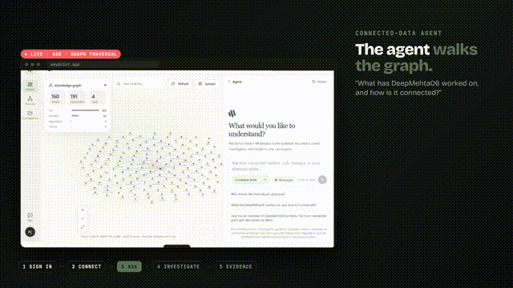
  </a>
  <br />
  <sub>Sign-in, a connected GitHub repository, a FalkorDB graph, and a live agent trace — followed by animated explainers of the graph model and the approval-to-draft-PR flow. <a href="https://youtu.be/lO6gwdgbC2M">Watch on YouTube →</a> · <a href="video/README.md">Recording notes →</a></sub>
</div>

<br />

<table>
<tr>
<td width="50%" align="center">
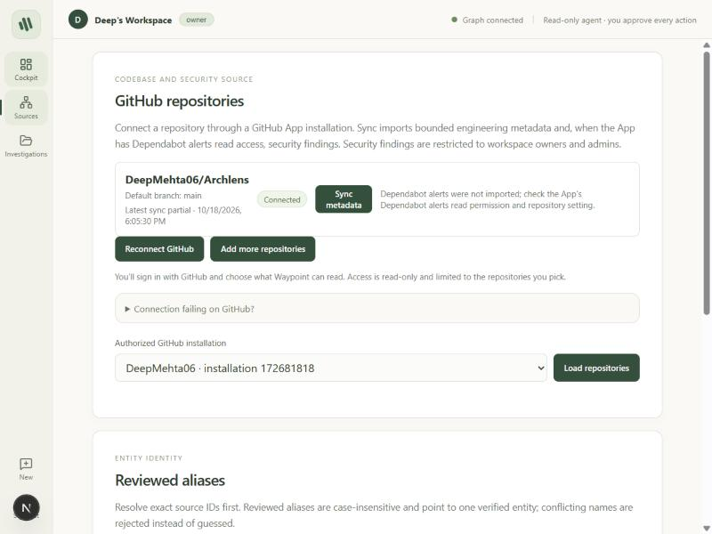<br />
<b>A real GitHub repository, connected</b>
</td>
<td width="50%" align="center">
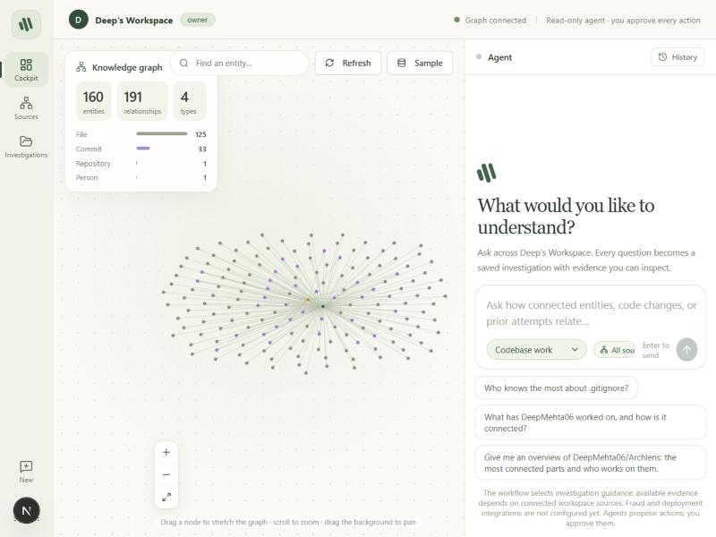<br />
<b>The agent traces the graph live</b>
</td>
</tr>
<tr>
<td align="center">
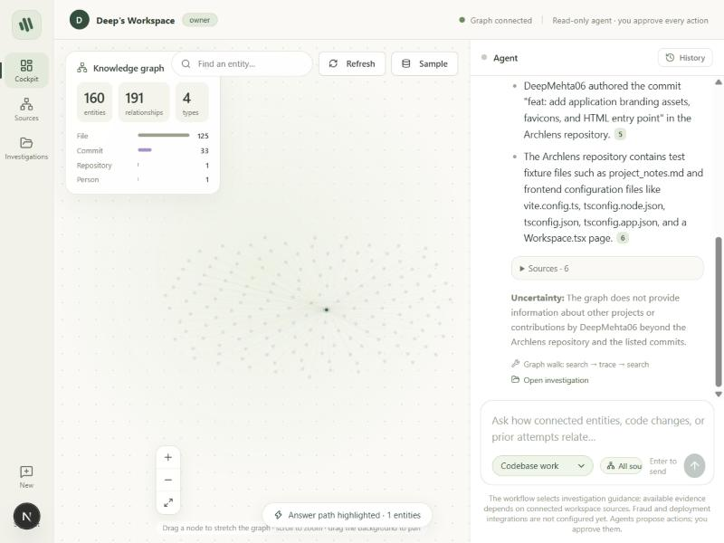<br />
<b>Every claim is cited — or it abstains</b>
</td>
<td align="center">
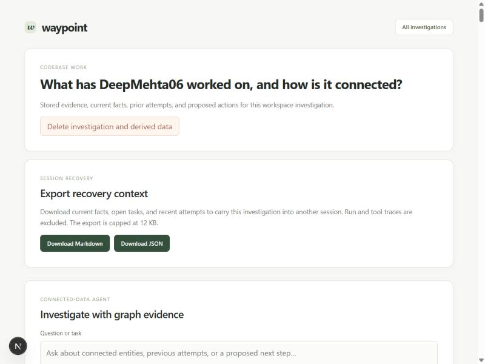<br />
<b>A durable, inspectable investigation</b>
</td>
</tr>
<tr>
<td align="center">
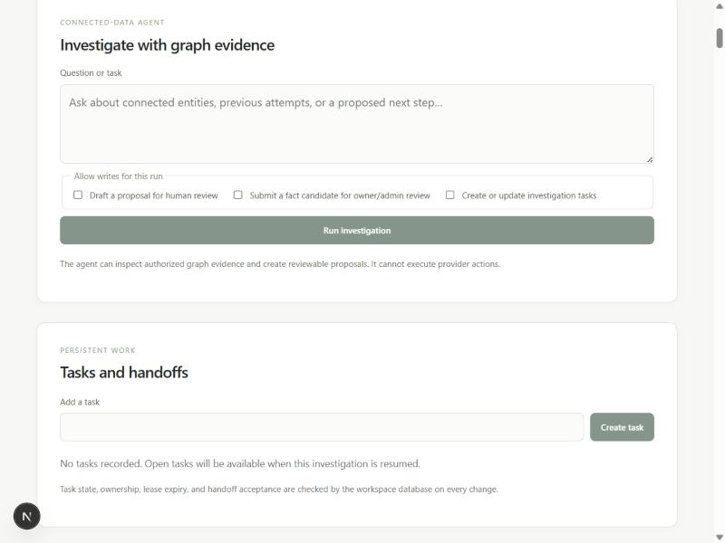<br />
<b>Tasks and handoffs — leased, not clobbered</b>
</td>
<td align="center">
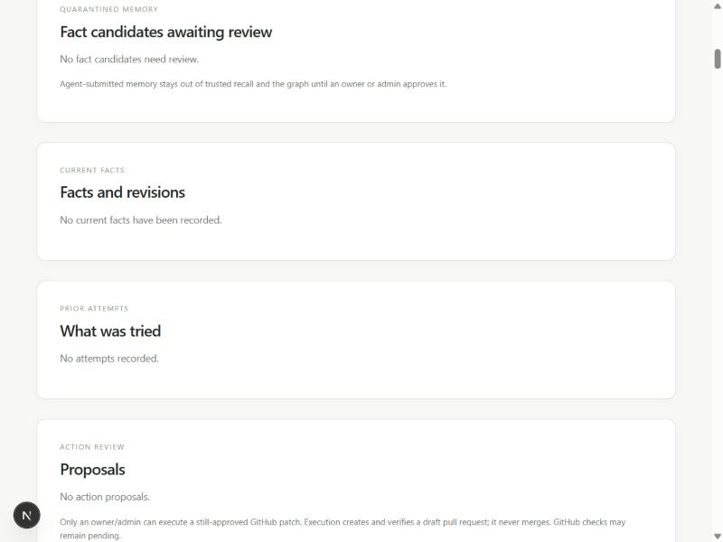<br />
<b>Proposals require human approval</b>
</td>
</tr>
</table>

<div align="center"><sub>Captured from the running app with a real connected GitHub repository and its live FalkorDB graph.</sub></div>

<br />

## What you can explore

| Capability | Experience |
|---|---|
| **Connected GitHub data** | Select repositories through a GitHub App and sync engineering metadata into your workspace. |
| **FalkorDB graph** | Explore files, commits, repositories, and contributors with interactive zoom, dragging, and repository scopes. |
| **Graph-guided answers** | Search, resolve, and traverse entities; inspect citations and the graph walk behind the answer. |
| **Persistent investigations** | Revisit evidence, run traces, facts, attempts, and recovery exports. |
| **Reviewed actions** | Review proposals, approve the exact change, and execute through a least-privilege, single-repository GitHub draft-PR path. |
| **MCP integration** | 18 authenticated tools and three workflow prompts; discovery tested with the official TypeScript SDK client. |

<br />

## The knowledge graph

Every workspace gets its own FalkorDB graph (`wp_<workspace-uuid>`). GitHub data and the
agent's own working memory live in the same graph, so a single traversal can connect
code, people, and prior investigations.

### Nodes and relationships

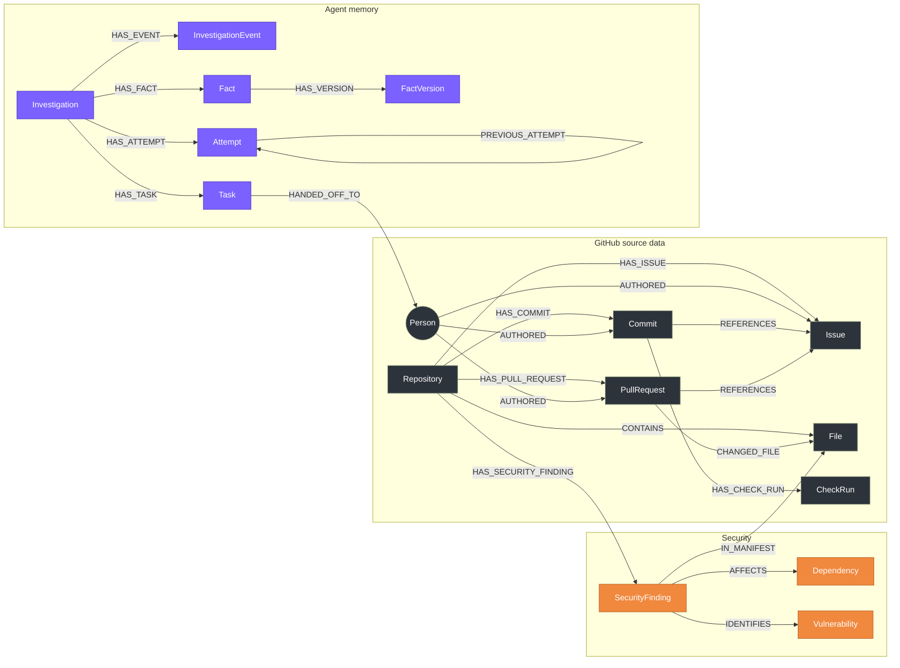

Every node and relationship carries `source_id`, `source_version`, `workspace_id`, and an
`acl_role`; each GitHub record also links to its prior versions through
`HAS_REVISION → SourceRevision`. Security findings are visible to owners and admins only.

### How the agent queries it

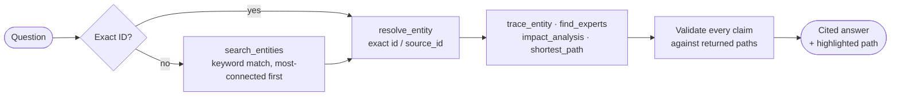

| Agent tool | Question it answers | Cypher pattern |
|---|---|---|
| `search_entities` | "What matches these keywords?" | `MATCH (n) WHERE <keyword on title/name/path>` … `ORDER BY degree DESC` |
| `resolve_entity` | "Which node is this exactly?" | `MATCH (n) WHERE n.id = $id OR n.source_id = $id` |
| `graph_overview` | "What's in this graph?" | label counts, relationship counts, top hubs |
| `trace_entity` | "What is this connected to?" | `MATCH p = (start)-[*1..4]-(related)` |
| `find_experts` | "Who knows about this?" | `MATCH p = (:Person)-[*1..3]-(target)` |
| `impact_analysis` | "What does this affect?" | `MATCH p = (t)-[*1..3]-(other)` |
| `shortest_path` | "How are these two related?" | `shortestPath((a)-[*..6]-(b))` |

Every traversal is bounded, parameter-bound, and checks access **on every node and
relationship in the path, inside the query itself**. Here's the core of `trace_entity`:

```cypher
MATCH p = (start)-[*1..4]-(related)
WHERE (start.id = $entity_id OR start.source_id = $entity_id)
  AND length(p) <= $max_depth
  AND all(node IN nodes(p)         WHERE <readable by caller's role>)
  AND all(edge IN relationships(p) WHERE <readable by caller's role>)
RETURN nodes(p), relationships(p)
LIMIT $limit
```

### Where the agent's decisions come from

FalkorDB is not a side store: **every answer Waypoint gives is assembled from graph
traversals, and the code rejects anything that isn't.**

| Step | What happens | Where in the code |
|---|---|---|
| Plan | The agent is instructed to work through the graph: search or resolve, then follow relationships with `trace_entity`, `find_experts`, `impact_analysis`, or `shortest_path`, preferring two or more hops of evidence. | `GRAPH_STRATEGY_PROMPT` in [`src/lib/agent-runner.ts`](src/lib/agent-runner.ts) |
| Retrieve | Each tool runs a bounded, ACL-filtered Cypher query against the workspace's FalkorDB graph and returns nodes, relationships, source IDs, and versions. | [`src/lib/graph-agent-tools.ts`](src/lib/graph-agent-tools.ts), [`src/lib/graph-tools.ts`](src/lib/graph-tools.ts) |
| Answer | Every claim must cite `sourceId` + `version` pairs copied from those tool results, and describe relationships exactly as the returned edge types say. | `SYSTEM_PROMPT` in [`src/lib/agent-runner.ts`](src/lib/agent-runner.ts) |
| Enforce | A claim whose citations didn't come from an authorized graph result in this run is **rejected**, and the agent abstains instead of answering. | answer validation in [`src/lib/agent-runner.ts`](src/lib/agent-runner.ts) |
| Show | The UI highlights the exact nodes and edges the agent walked, and the run trace stores every `GRAPH.QUERY`-backed tool call. | Cockpit graph view, investigation run traces |

Full details, including entity resolution and aliases, are in
[docs/Architecture/GRAPH_MODEL.md](docs/Architecture/GRAPH_MODEL.md).

<br />

## How it works

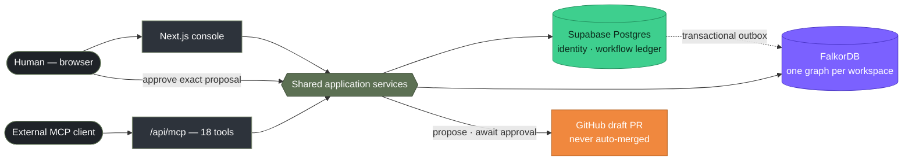

**How an answer is built**

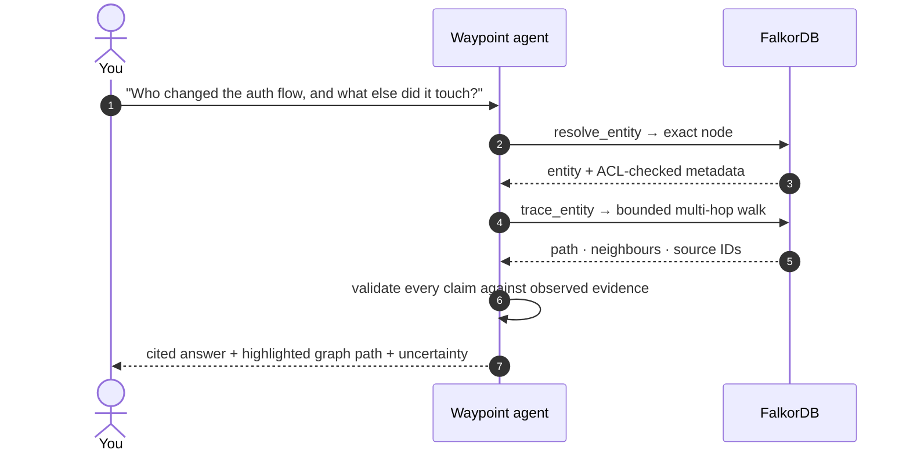

See [the full sequence diagrams](docs/Architecture/SYSTEM_ARCHITECTURE.md) for the
agent-run loop and the approval-to-draft-PR flow.

<br />

## Built with

<div align="center">

<a href="https://www.falkordb.com"></a>&nbsp;


</div>

| Tool | Role in Waypoint |
|---|---|
| **FalkorDB** · FalkorDB Cloud in production | The reasoning graph — not a display layer. One graph per workspace, server-derived names, role-scoped ACLs enforced inside every Cypher query. |
| **Model Context Protocol** · official TypeScript SDK | `/api/mcp` publishes 18 tools and 3 domain prompts; `bun run test:mcp-sdk` connects the real client library and discovers them. |
| **Supabase** · Auth + Postgres | Identity, RLS-scoped workspace membership, and the authoritative transactional store for investigations, facts, tasks, and approvals. |
| **GitHub App** | Least-privilege source connection and scoped, short-lived, single-use draft-PR execution tokens. |
| **Any OpenAI-compatible model** | Built and evaluated against Groq (`openai/gpt-oss-20b`); switching providers is a 3-env-var change. |
| **Vercel** | Production hosting for the Next.js app. |
| **Claude Code** | Used to build this project and to produce the submission video — disclosed per hackathon rule 11 ([`video/youtube.md`](video/youtube.md)). |

<sub>Also: shadcn/ui and Remotion (video production). No other sponsor integrations.</sub>

<br />

## Quick start

Run Waypoint locally in a few minutes. You'll need **Bun 1.3.9**, Node.js, Docker, a
Supabase project, GitHub App credentials, and a model-provider key.

**1 · Install**

```bash
git clone https://github.com/AVENGERSTHE2102/BroCode.git waypoint
cd waypoint
bun install --frozen-lockfile
```

**2 · Configure** — copy `.env.example` to `.env` and fill in your credentials. Supabase's
URL, publishable key, service key, and database connection must belong to the same
project. If `.env.local` exists, its values take precedence over `.env`.

**3 · Start the graph**

```bash
docker run -d --name falkordb -p 16379:6379 -p 3002:3000 -v falkordb_data:/data falkordb/falkordb:latest
```

Set `FALKORDB_URL=falkor://localhost:16379` (or point it at a FalkorDB Cloud instance).
For an existing container, use `docker start falkordb`.

**4 · Prepare the database** — apply the Supabase migrations in filename order
([runbook](TESTING.md#24-apply-database-migrations-if-needed)).

**5 · Run**

```bash
bun run dev
```

Open **http://localhost:3000** → sign in → **Sources → Connect GitHub** (or
**Already installed on GitHub? Link it**) → connect a repository → **Sync metadata** →
pick the repository scope in the cockpit and ask a question. Sync starts graph projection
automatically; the owner/admin **Refresh** control can also project saved records.

**6 · Verify**

```bash
bun run typecheck
bun run test:contracts
```

> [!NOTE]
> On Windows PowerShell, use `bun.cmd` if the `bun.ps1` wrapper is blocked, and
> `Copy-Item .env.example .env` to create the environment file. The full
> [runbook](TESTING.md) covers credentials, migrations, graph health, and first-run checks.

<br />

## Documentation

<details>
<summary><b>Browse every guide</b></summary>
<br />

| Area | Documentation |
|---|---|
| API | [Every REST route and all 18 MCP tools](docs/API/API_REFERENCE.md) |
| Architecture | [System diagram, agent-run and approval sequences, trust boundaries](docs/Architecture/SYSTEM_ARCHITECTURE.md) |
| Graph model | [What's in FalkorDB, the real traversal Cypher](docs/Architecture/GRAPH_MODEL.md) |
| Backend | [Module map, the agent loop's invariants](docs/Backend/BACKEND_GUIDE.md) |
| Database | [Supabase schema, migrations, idempotency](docs/Database/DATABASE_DESIGN.md) |
| Decisions | [Short-form ADRs — why the system is shaped this way](docs/Decisions/DECISIONS.md) |
| Setup | [Local setup, managed services, env vars](docs/Setup/SETUP_GUIDE.md) |
| Development | [Pre-PR checks, conventions, gotchas](docs/Development/DEVELOPMENT_GUIDE.md) |
| Frontend | [Routes, the Cockpit, component sources](docs/Frontend/FRONTEND_GUIDE.md) |
| Operations | [Credentials, deletion, recovery, incident response](docs/Operations/OPERATIONS_GUIDE.md) |
| Product | [Pain points and proof contract, user journey](docs/Product/PRODUCT_PLAN.md) |
| Evidence | [Live verification, contract tests, eval harness](docs/Product/IMPACT_AND_EVIDENCE.md) |

Full index: [docs/DOCUMENTATION_INDEX.md](docs/DOCUMENTATION_INDEX.md) ·
Milestone evidence: [IMPLEMENTATION_TRACKER.md](IMPLEMENTATION_TRACKER.md) ·
Eval reports: [docs/Product/eval-results](docs/Product/eval-results/README.md)

</details>

<details>
<summary><b>Repository map</b></summary>
<br />

```text
Brocode_GraphHacks/
├── src/
│   ├── app/              # Next.js routes: cockpit, investigations, API routes, MCP endpoint
│   ├── components/       # Cockpit, graph canvas/explorer, landing page, shared UI
│   └── lib/              # Graph tools, agent runner, action proposals, facts/attempts/tasks, GitHub App
├── supabase/migrations/  # 24 ordered SQL migrations — see docs/Database
├── scripts/              # Contract checks (bun run test:contracts), eval harness, diagnostics
├── eval/                 # Synthetic + LoCoMo-derived evaluation fixtures
├── docs/                 # API, Architecture, Backend, Database, Decisions, Setup,
│                         # Development, Frontend, Operations, Product, assets
├── video/                # Remotion project + the rendered demo video (video/dist/)
├── IMPLEMENTATION_TRACKER.md  # Milestone/evidence log
├── TESTING.md                 # Runbook for a clean checkout (humans and AI agents)
└── AGENTS.md                  # Repository instructions for coding agents
```

</details>

<br />

## Team

<table align="center">
  <tr>
    <td align="center" width="33%">
      <a href="https://github.com/DeepMehta06">
        <br />
        <strong>DeepMehta06</strong>
      </a>
    </td>
    <td align="center" width="33%">
      <a href="https://github.com/AVENGERSTHE2102">
        <br />
        <strong>AVENGERSTHE2102</strong>
      </a>
    </td>
    <td align="center" width="33%">
      <a href="https://github.com/devikabongarde">
        <br />
        <strong>devikabongarde</strong>
      </a>
    </td>
  </tr>
</table>

<div align="center">
<br />

**Waypoint** — built for **GraphHacks** · [Try it live →](https://waypoint-one-mu.vercel.app)

</div>
