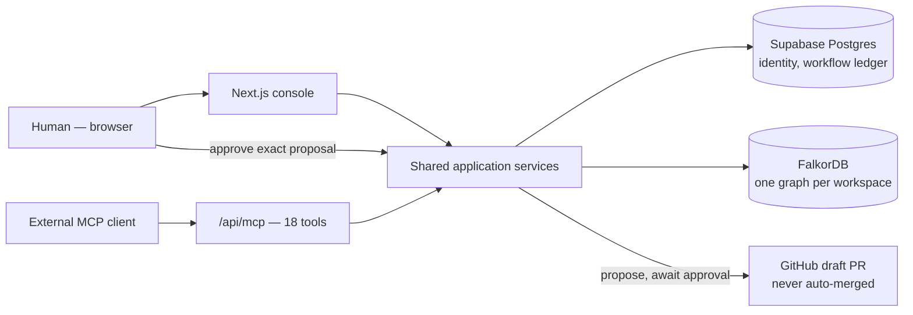

# Waypoint

<div align="center">
  
  <br /><br />
  <strong>An action-first agent for connected operational data — graph reasoning your team can actually trust, with a human in the loop on every action.</strong>
  <br /><br />
  
  
  
  
  <br /><br />
  <a href="#quick-start">Quick start</a> ·
  <a href="video/dist/waypoint-demo.mp4">Demo video</a> ·
  <a href="docs/DOCUMENTATION_INDEX.md">Documentation</a> ·
  <a href="docs/Product/IMPACT_AND_EVIDENCE.md">Evidence</a> ·
  <a href="IMPLEMENTATION_TRACKER.md">Implementation tracker</a>
</div>

Waypoint helps engineering teams understand their code through connected evidence.
Connect a GitHub repository, explore its relationships, and ask questions about changes,
contributors, and related work. **FalkorDB powers the graph the agent traverses** through
bounded `GRAPH.QUERY` calls. Answers carry source citations, visible graph paths, and
clear uncertainty where more evidence would help.

Investigations preserve context across sessions. The action workflow separates proposals,
human review, and execution: the GitHub executor is built to open **draft pull requests
only**, with approval hash-bound to the exact proposed change.

## Why Waypoint stands out

- **The graph does the reasoning.** The agent walks FalkorDB with bounded multi-hop
  `GRAPH.QUERY` traversals, and every answer shows the exact path it followed.
- **Cited or silent.** Final answers are validated against observed tool-call evidence;
  when the graph doesn't support a claim, Waypoint says so instead of guessing.
- **Approval means *this exact change*.** Approvals are bound to a SHA-256 hash of the
  proposal's target, inputs, and evidence — any drift invalidates them automatically.
- **Memory that can't be poisoned.** Agent-submitted facts are quarantined until an
  owner/admin approves them, so untrusted source content never becomes trusted memory.
- **Tenant isolation at every layer.** Supabase RLS, server-derived graph names, and
  role-scoped ACLs enforced inside every Cypher query.
- **Built to be correct under concurrency.** A transactional outbox, leases, and
  idempotency keys on every write mean retries never double-execute.
- **Open by protocol.** 18 authenticated MCP tools and 3 workflow prompts, verified with
  the official MCP TypeScript SDK client.

Submitted for **GraphHacks** — primary track **Agents That Act on Connected Data**, with
supporting tracks **Company Brain** and **Agent Memory and Coordination**. Built with
AI-assisted development (Claude Code), disclosed per the hackathon's rule 11 — see
[`video/youtube.md`](video/youtube.md).

## Demo

<div align="center">
  <a href="video/dist/waypoint-demo.mp4">
    
  </a>
  <br />
  <sub>The opening ~75 seconds show the running local app: sign-in, a connected GitHub repository, a FalkorDB graph, and a live agent trace. Graph-model and approval-to-draft-PR scenes are animated explainers. See <a href="video/README.md">the recording notes</a> for the walkthrough and scene details.</sub>
</div>

### Product walkthrough

| Real GitHub repository, actually connected | The agent traces the graph live |
|---|---|
|  |  |

| Every claim is cited, or it abstains | A durable, inspectable investigation |
|---|---|
|  |  |

| Tasks and handoffs, leased not clobbered | Proposals require human approval |
|---|---|
|  |  |

Screenshots captured from the running app on 2026-10-18, with a real connected GitHub
repository and its live FalkorDB graph.

## What you can explore

| Capability | Experience |
|---|---|
| Connected GitHub data | Select repositories through a GitHub App and sync engineering metadata into your workspace. |
| FalkorDB graph | Explore files, commits, repositories, and contributors with interactive zoom, dragging, and repository scopes. |
| Graph-guided answers | Search, resolve, and traverse entities; inspect citations and the graph walk behind the answer. |
| Persistent investigations | Revisit evidence, run traces, facts, attempts, and recovery exports. |
| Reviewed actions | Review proposals, approve the exact change, and execute through a least-privilege, single-repository GitHub draft-PR path. |
| MCP integration | 18 authenticated tools and three workflow prompts; discovery tested with the official TypeScript SDK client. |

The full GitHub → FalkorDB → cited-answer workflow runs live against real repository
data, and every release check passes: **production build, TypeScript, and all 27
contract test scripts**. See [Impact and evidence](docs/Product/IMPACT_AND_EVIDENCE.md)
for the verification record.

## Documentation

| Area | Documentation |
|---|---|
| API | [Every REST route and all 18 MCP tools](docs/API/API_REFERENCE.md) |
| Architecture | [System diagram, agent-run and approval sequences, trust boundaries](docs/Architecture/SYSTEM_ARCHITECTURE.md) |
| Graph model | [What's in FalkorDB today, the real traversal Cypher](docs/Architecture/GRAPH_MODEL.md) |
| Backend | [Module map, the agent loop's invariants](docs/Backend/BACKEND_GUIDE.md) |
| Database | [Supabase schema, migrations, idempotency](docs/Database/DATABASE_DESIGN.md) |
| Decisions | [Short-form ADRs — why the system is shaped this way](docs/Decisions/DECISIONS.md) |
| Setup | [Local setup, managed services, env vars](docs/Setup/SETUP_GUIDE.md) |
| Development | [Pre-PR checks, conventions, gotchas](docs/Development/DEVELOPMENT_GUIDE.md) |
| Frontend | [Routes, the Cockpit, component sources](docs/Frontend/FRONTEND_GUIDE.md) |
| Operations | [Credentials, deletion, recovery, incident response](docs/Operations/OPERATIONS_GUIDE.md) |
| Product | [Pain points and proof contract, user journey](docs/Product/PRODUCT_PLAN.md) |

Full index: [docs/DOCUMENTATION_INDEX.md](docs/DOCUMENTATION_INDEX.md).

## Quick start

Use **Bun 1.3.9**, Node.js, and a running Docker engine. You will also need a Supabase
project, GitHub App credentials, and a model-provider key in your local environment.

```bash
git clone https://github.com/AVENGERSTHE2102/BroCode.git waypoint
cd waypoint
bun install --frozen-lockfile
```

Copy `.env.example` to `.env` and fill in your own credentials. Supabase's URL,
publishable key, service key, and database connection must belong to the same project.
If `.env.local` exists, its values take precedence over `.env`.

Start the local graph database:

```bash
docker run -d --name falkordb -p 16379:6379 -p 3002:3000 -v falkordb_data:/data falkordb/falkordb:latest
```

For an existing container, use `docker start falkordb`. Set
`FALKORDB_URL=falkor://localhost:16379`, apply the Supabase migrations in filename
order to a new project using [the runbook](TESTING.md#24-apply-database-migrations-if-needed),
then start the app:

```bash
bun run dev
```

Open **http://localhost:3000**. Sign in, create or choose a workspace, and open
**Sources → Connect GitHub**. If the App is already installed, choose
**Already installed on GitHub? Link it**. Load repositories, connect one, and select
**Sync metadata**. Return to the cockpit, choose the repository scope, and ask a question.
Sync starts graph projection automatically; the owner/admin **Refresh** control can
also project saved records.

On Windows PowerShell, use `bun.cmd` if the `bun.ps1` wrapper is blocked, and use
`Copy-Item .env.example .env` when creating the environment file for the first time.

Offline verification:

```bash
bun run typecheck
bun run test:contracts
```

The full [runbook](TESTING.md) covers credentials, migrations, graph health, and
first-run checks.

## How Waypoint works



The agent can search the graph, resolve an identifier, and follow related entities with
bounded multi-hop `GRAPH.QUERY` traversal. The UI exposes the resulting evidence and
highlights the graph path. See [the full sequence diagrams](docs/Architecture/SYSTEM_ARCHITECTURE.md)
for the agent-run loop and the approval-to-draft-PR flow.

## Built with

| Tool | Role in Waypoint |
|---|---|
| FalkorDB | The reasoning graph — not a display layer. One graph per workspace, server-derived names, role-scoped ACLs enforced inside every Cypher query. |
| Model Context Protocol (official TypeScript SDK) | `/api/mcp` publishes 18 tools and 3 domain prompts; `bun run test:mcp-sdk` connects the real client library and discovers them. |
| Supabase (Auth + Postgres) | Identity, RLS-scoped workspace membership, and the authoritative transactional store for investigations, facts, tasks, and approvals. |
| GitHub App | Least-privilege source connection and scoped, short-lived, single-use draft-PR execution tokens. |
| Any OpenAI-compatible model provider | Built and evaluated against Groq's free tier (`openai/gpt-oss-20b`); switching providers is a 3-env-var change. |
| Claude Code | Used to build this project and to produce the submission video — disclosed per hackathon rule 11. |

Other tools: Next.js, TypeScript, Tailwind, shadcn/ui, Remotion (video production). No
other sponsor integrations.

## Repository map

```text
Brocode_GraphHacks/
├── src/
│   ├── app/              # Next.js routes: cockpit, investigations, API routes, MCP endpoint
│   ├── components/       # Cockpit, graph canvas/explorer, landing page, shared UI
│   └── lib/               # Graph tools, agent runner, action proposals, facts/attempts/tasks, GitHub App
├── supabase/migrations/  # 23 ordered SQL migrations — see docs/Database
├── scripts/              # Offline contract checks (bun run test:contracts), eval harness, diagnostics
├── eval/                 # Synthetic + LoCoMo-derived evaluation fixtures
├── docs/
│   ├── API/               # REST + MCP contract reference
│   ├── Architecture/       # System diagram, graph model, sequence diagrams
│   ├── Backend/            # Module map, agent-loop invariants
│   ├── Database/           # Supabase schema and migration design
│   ├── Decisions/          # Short-form architecture decision records
│   ├── Setup/              # Local setup, managed services, env vars
│   ├── Development/        # Pre-PR checks, conventions, gotchas
│   ├── Frontend/           # Routes, components, design notes
│   ├── Operations/         # Credentials, deletion, recovery, incident response
│   ├── Product/            # Plan, evidence, research archive, eval results
│   └── assets/screenshots/ # Real screenshots used in this README
├── video/                 # Remotion project + the rendered demo video (video/dist/)
├── IMPLEMENTATION_TRACKER.md  # Authoritative milestone/evidence log
├── TESTING.md                 # Runbook for a clean checkout (humans and AI agents)
└── AGENTS.md                  # Repository instructions for coding agents
```

## Contributors

<table align="center">
  <tr>
    <td align="center" width="33%">
      <a href="https://github.com/DeepMehta06">
        <br />
        <strong>DeepMehta06</strong>
      </a>
    </td>
    <td align="center" width="33%">
      <a href="https://github.com/AVENGERSTHE2102">
        <br />
        <strong>AVENGERSTHE2102</strong>
      </a>
    </td>
    <td align="center" width="33%">
      <a href="https://github.com/devikabongarde">
        <br />
        <strong>devikabongarde</strong>
      </a>
    </td>
  </tr>
</table>

## Evidence

The [implementation tracker](IMPLEMENTATION_TRACKER.md) records delivery evidence per
milestone. The [evaluation results](docs/Product/eval-results/README.md) document the
three-way graph vs. text-retrieval vs. Markdown-memory comparison.
