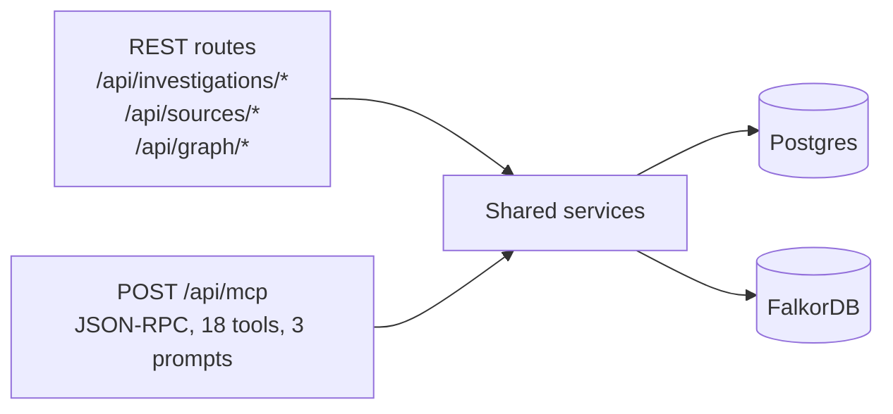

# API reference

Two entry points call the same authorized application services (see
`docs/Architecture/SYSTEM_ARCHITECTURE.md`): the REST API under `/api/*` for the web
console, and `POST /api/mcp` — a single JSON-RPC endpoint — for MCP tool-calling clients
(the in-app agent runner included). Nothing here bypasses workspace authorization: every
route resolves the caller's Supabase session and workspace membership first.

## MCP endpoint — `/api/mcp`

Authenticated JSON-RPC Streamable HTTP. Supports the legacy `initialize` handshake and
the stateless `2026-07-28` discovery/tools/prompts flow; the official MCP TypeScript SDK
connects to it and discovers all tools and prompts (`bun run test:mcp-sdk`).

### Tools (18)

| Tool | Purpose |
|---|---|
| `resolve_entity` | Resolve an entity by exact source/entity ID or a reviewed alias; ambiguous matches return candidates, not a pick. |
| `trace_entity` | Bounded multi-hop graph paths (1–4 hops) around an entity. |
| `search_entities` | Keyword search across people, files, PRs, issues, services, decisions by title/name/path/ID. |
| `graph_overview` | Entity/relationship type counts and the most-connected entities — good for "orient me" questions. |
| `find_experts` | Who's connected to an entity within 3 hops (authored it, changed its files, owns it). |
| `impact_analysis` | Blast radius: everything within 1–3 hops, grouped by type and distance. |
| `shortest_path` | Shortest connection (≤6 hops) between two named entities. |
| `recall_facts` | Current facts + provenance for an investigation. |
| `recall_attempts` | Prior attempts and their outcomes — required before `propose_action` can be called for a repeat. |
| `remember_fact` | Submit a fact **candidate** — quarantined until owner/admin review, never auto-trusted. |
| `list_tasks` / `create_task` / `claim_task` / `handoff_task` / `acknowledge_task_handoff` / `complete_task` | Full task lifecycle: idempotent creation, leased exclusive claims, handoff + acknowledgement. |
| `propose_action` | Create a reviewable action proposal (`github_patch` or `deployment_rollback`). Never approves or executes. |
| `explain_evidence` | Return only explicitly linked investigation events for a claim; abstains if none resolve. |

### Prompts (3)

Domain-specific investigation prompt templates for `fraud_investigation`,
`security_triage`, and `codebase_work` — returned as validated prompt instances, not raw
strings.

## REST API

### Investigations

| Route | Method | Purpose |
|---|---|---|
| `/api/investigations` | `GET`, `POST` | List / create a durable investigation with a required `workflow_domain`. |
| `/api/investigations/:id` | `GET` | Investigation detail: stored evidence, facts, tasks, proposals. |
| `/api/investigations/:id/run` | `POST` | Run the agent loop (read-only by default; `requestedWrites` opts into `proposals`/`factCandidates`/`taskUpdates` with an explicit lexical-intent gate). |
| `/api/investigations/:id/runs`, `/runs/:runId/events` | `GET` | Run history; `events` is a Server-Sent Events stream of durable run-trace events, resumable via `Last-Event-ID`. |
| `/api/investigations/:id/facts`, `/facts/candidates` | `GET`/`POST` | Current facts and quarantined candidates. |
| `/api/investigations/:id/facts/candidates/:candidateId/review` | `POST` | Owner/admin approve/reject a fact candidate. |
| `/api/investigations/:id/attempts` | `GET`/`POST` | Prior-attempt log with changed-condition requirements on retry. |
| `/api/investigations/:id/tasks`, `/tasks/:taskId` | `GET`/`POST` | Task lifecycle for the web UI. |
| `/api/investigations/:id/action-proposals` | `GET`/`POST` | List / create action proposals. |
| `/api/investigations/:id/action-proposals/:proposalId/review` | `POST` | Owner/admin approve/reject — binds an immutable decision to the proposal's content hash. |
| `/api/investigations/:id/action-proposals/:proposalId/execute` | `POST` | Owner/admin-only. Claims a 10-minute lease, re-verifies hash/evidence/base SHA, executes via GitHub, records the observed result. Never merges. |
| `/api/investigations/:id/events` | `GET` | Full append-only event log for the investigation. |
| `/api/investigations/:id/forget` | `POST` | Owner/admin permanent deletion — cascades Postgres rows, invalidates open proposals, waits for graph-outbox confirmation before completing. |

### Sources (GitHub)

| Route | Method | Purpose |
|---|---|---|
| `/api/sources/github` | `GET` | List connected repositories and sync status. |
| `/api/sources/github/install-url`, `/callback` | — | GitHub App OAuth install flow; state is signed and bound to the current workspace/user. |
| `/api/sources/github/installations`, `/repositories` | `GET` | Available installations / repositories to connect. |
| `/api/sources/github/setup` | `POST` | Bind a selected repository to the workspace. |
| `/api/sources/github/:sourceId/sync` | `POST` | Owner/admin-triggered bounded metadata sync (commits, issues, PRs, file metadata, check runs, optional Dependabot). |

### Graph

| Route | Method | Purpose |
|---|---|---|
| `/api/graph/explore` | `GET` | Role-ACL-filtered graph read backing the Knowledge Graph explorer. |
| `/api/graph/health` | `GET` | Authenticated FalkorDB + Supabase dependency status and latency (sanitized — no endpoint/credentials exposed). |
| `/api/graph/impact` | `GET` | Blast-radius analysis grouped into hop rings, wired into the cockpit UI. |
| `/api/graph/project` | `POST` | Trigger projection of newly-synced records into the graph. |
| `/api/graph/sample` | `POST`/`DELETE` | Load/remove a clearly-labeled synthetic sample graph for demo purposes (`sample: true`, never agent evidence). |

### Other

| Route | Method | Purpose |
|---|---|---|
| `/api/health/live` | `GET` | Dependency-free liveness probe — excluded from session middleware. |
| `/api/ask` | `POST` | One-shot read-only Ask: creates an investigation and runs the agent with every write permission off. |
| `/api/entity-aliases`, `/:aliasId` | `GET`/`POST`/`DELETE` | Owner/admin reviewed-alias management. |
| `/api/workspace-members` | `GET` | Workspace member list (ID + role only) for handoff targets. |
| `/api/forget-requests/:id` | `GET` | Status of an in-flight deletion request. |

## Request hardening (applies across the API)

- **Same-origin required** on every state-changing route (`src/lib/same-origin.ts`,
  verified on 18 routes by `bun run test:same-origin`).
- **Byte-bounded, streaming-safe JSON body parsing** (`src/lib/read-json-body.ts`) rejects
  oversized or malformed-UTF-8 bodies before they reach a handler.
- **Per-workspace rate limiting** on the agent-run, ask-delegation, and GitHub-sync routes
  via a membership-checked, `SECURITY DEFINER`-isolated Postgres RPC.
- **Idempotency keys** required on every write that could otherwise double-apply on retry.
