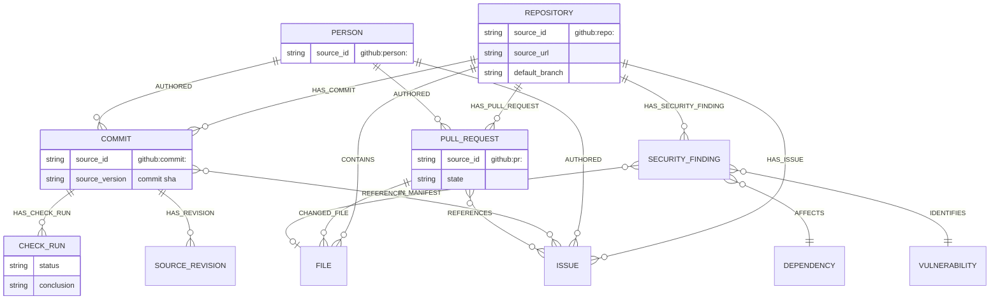

# Graph model

Each workspace gets a dedicated FalkorDB graph, named `wp_<workspace-uuid>` and derived
server-side only after Supabase verifies the caller's membership (`src/lib/graph-tools.ts`).
A client can never choose or override a graph name.

## Access control on every read

Graph reads filter by the authenticated membership role:

- `workspace` records are visible to any workspace member.
- role-scoped records require a matching role.
- `admin` records (e.g. Dependabot security findings) are visible only to owners/admins.

Multi-hop traces apply the **same check to every node and relationship in the path**, not
just the start/end entities — missing ACL metadata is denied by default, not allowed by
default. This is enforced in `traceGraphEntity`'s Cypher itself (see below), not as a
post-filter on the result.

## Entities actually projected today (codebase workflow)



This is what a live GitHub App connection actually populates — confirmed against a real
connected repository (`DeepMehta06/Archlens`) on 2026-10-18: 160 entities, 191
relationships, 4 types (`File`, `Commit`, `Repository`, `Person`).

## Extended entity model

| Label group | Source identity | Workflow |
|---|---|---|
| `Account`, `Transaction`, `Device`, `Counterparty`, `FraudCase` | Stable IDs from a fraud/case provider | Fraud investigation |
| `Service`, `Deployment`, `Incident`, `Runbook` | Provider IDs, canonical URLs | Cloud operations |

These labels are part of the prompt/tool-schema layer, so the agent reasons about them
with the same tools and ACLs as the codebase entities.

## Waypoint-native entities (not from an external source)

`Investigation`, `InvestigationEvent`, `Attempt`, `Task`, `Fact`, `Action` (proposal) are
Waypoint-generated, UUID-keyed, and live primarily in **Postgres** (see
`docs/Database/DATABASE_DESIGN.md`) — only a bounded, access-filtered projection of them
is pushed into the graph through the transactional outbox, for traversal purposes.
Postgres, not the graph, is authoritative for all of these.

## The actual traversal query

This is the real, current Cypher from `traceGraphEntity` in `src/lib/graph-tools.ts` —
not a simplified or invented version:

```cypher
MATCH p = (start)-[*1..4]-(related)
WHERE (start.id = $entity_id OR start.source_id = $entity_id)
  AND length(p) <= $max_depth
  AND all(node IN nodes(p) WHERE <readable-by-role ACL clause>)
  AND all(node IN nodes(p) WHERE <scope clause: all | sample | one repository>)
  AND all(edge IN relationships(p) WHERE <readable-by-role ACL clause>)
RETURN
  toJSON([node IN nodes(p) | {
    labels: labels(node), id: node.id, source_id: node.source_id,
    source_version: node.source_version,
    title: coalesce(node.title, node.name, node.path, node.fact_key),
    source_url: node.source_url
  }]) AS nodes,
  toJSON([edge IN relationships(p) | {
    type: type(edge), source_id: edge.source_id, source_version: edge.source_version
  }]) AS relationships
LIMIT $limit
```

Bounded to 1–4 hops (`maxDepth`), parameter-bound (never string-interpolated), and the ACL
clause is evaluated per-node/per-edge *inside* the query, not filtered afterward in
application code.

## Entity resolution

Lookup is **exact first**: by graph ID or by the provider's own source ID
(`github:commit:<sha>`, `github:repo:<id>`, …). Owners/admins can register a
case-insensitive alias, but only after the target already resolves to exactly one
accessible entity — duplicate aliases are rejected, and an ambiguous name returns
candidates for human review rather than guessing. Alias assignment is an explicit,
audited control-plane action, never fuzzy similarity matching, and candidate (unresolved)
entities never count as cited evidence.

## Relationship types

Source data: `CONTAINS`, `HAS_COMMIT`, `HAS_PULL_REQUEST`, `HAS_ISSUE`, `AUTHORED`,
`CHANGED_FILE`, `HAS_CHECK_RUN`, `REFERENCES`, `HAS_REVISION`. Security: `HAS_SECURITY_FINDING`,
`AFFECTS`, `IDENTIFIES`, `IN_MANIFEST`. Agent memory: `HAS_EVENT`, `HAS_FACT`, `HAS_VERSION`,
`HAS_ATTEMPT`, `PREVIOUS_ATTEMPT`, `HAS_TASK`, `HANDED_OFF_TO`. All are written by
`src/lib/graph-projection.ts`.
