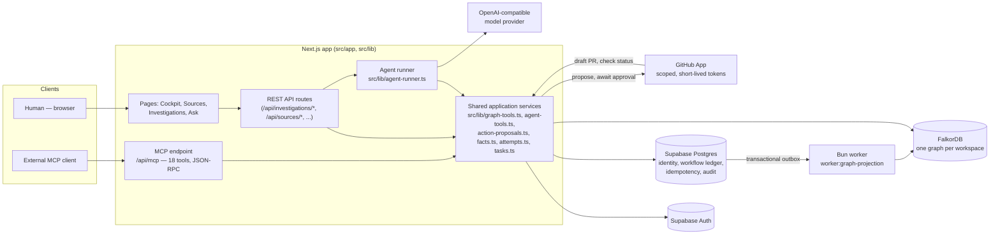

# System architecture

Waypoint is a modular monolith: a Next.js app whose REST routes, MCP endpoint, and
background worker all call the same server-side application services in `src/lib/`.
There is no separate "agent service" — the same authorization, validation, and graph
code path runs whether the caller is a human in the browser, an MCP tool-calling model,
or the scheduled projection worker.

## Components



**Why an outbox instead of dual-writing.** Postgres is the single source of truth for
mutable workflow state (investigations, facts, attempts, tasks, proposals, approvals).
A request never writes directly to FalkorDB. Instead it writes to Postgres inside a
transaction that also enqueues an outbox row; `worker:graph-projection` drains that
queue under a database lease, with retry/backoff and a dead-letter path for rows that
keep failing. This means a crashed request can never leave the graph half-updated, and
the graph can always be rebuilt by replaying the outbox.

**Why the graph name is never client-supplied.** Each workspace gets its own FalkorDB
graph, named `wp_<workspace-uuid>` *after* Supabase has verified the caller's workspace
membership — see `src/lib/graph-tools.ts` and `docs/Architecture/GRAPH_MODEL.md`. A
request can never select which graph it reads.

## A graph-traversal request, end to end

```mermaid
sequenceDiagram
    participant U as User (Ask box)
    participant API as POST /api/investigations/:id/run
    participant Loop as runToolSelectionLoop
    participant LLM as Model provider (Groq / OpenAI-compatible)
    participant MCP as invokeMcpTool
    participant FDB as FalkorDB

    U->>API: question, workflow domain
    API->>API: workspace auth, rate limit, idempotency key
    Loop->>LLM: system prompt + question + tool schemas
    LLM-->>Loop: tool_call resolve_entity
    Loop->>MCP: resolve_entity(query, investigationId)
    MCP->>FDB: GRAPH.QUERY (ACL-filtered)
    FDB-->>MCP: matching entities
    MCP-->>Loop: result + evidenceId
    Loop->>LLM: tool result appended to conversation
    LLM-->>Loop: tool_call trace_entity
    Loop->>MCP: trace_entity(entityId, maxDepth<=4)
    MCP->>FDB: bounded multi-hop MATCH
    FDB-->>MCP: path nodes + relationships
    MCP-->>Loop: result + graphPaths
    Loop->>LLM: tool result appended
    LLM-->>Loop: final JSON — claims + citations, or abstained
    Loop-->>API: validated answer (citations checked against observed evidence)
    API-->>U: cited answer, graph path highlighted, run trace stored
```

Every step in that loop is capped: at most 4 tool calls per run
(`MAX_AGENT_TOOL_CALLS`), each tool result bounded to 16KB, and every tool call plus the
final answer written as an immutable run-trace event (`src/lib/run-traces.ts`) before the
response returns. The model's final answer is **validated, not trusted**: a citation that
doesn't match a source ID/version actually returned by an authorized tool call in that
same run is rejected, and the run abstains (`abstained: true`, no claims) rather than
answer with unsupported evidence.

## The approval gate — how a GitHub action actually lands

```mermaid
sequenceDiagram
    participant Agent as Agent / model
    participant Prop as action-proposals.ts
    participant PG as Postgres
    participant Own as Owner/admin (human)
    participant Exec as GitHub execution route
    participant GH as GitHub API

    Agent->>Prop: propose_action(github_patch, repo, baseSha, diff, evidence)
    Prop->>Prop: require successful recall_attempts first;\nchangedConditions cited if a prior attempt failed
    Prop->>PG: store proposal + SHA-256 content hash (idempotency key)
    Own->>PG: review exact diff + evidence, approve
    PG->>PG: immutable approval row bound to content hash
    Own->>Exec: POST .../execute
    Exec->>PG: 10-minute execution lease (prevents duplicate runs)
    Exec->>PG: recheck approval, hash, evidence freshness, pinned base SHA
    Exec->>GH: short-lived token (one repo, contents+PR write)
    Exec->>GH: create deterministic branch + commit + draft PR
    GH-->>Exec: PR number, head/base SHAs, check status
    Exec->>Exec: revoke token immediately
    Exec->>PG: record observed PR state (never "success" without this read-back)
```

A proposal is invalidated the moment its target, inputs, or cited evidence version
changes — approval is bound to an exact content hash, not a "yes" on a mutable record.
Execution **never merges**; it only ever creates a draft PR and reports what GitHub
actually returned. See `docs/Backend/BACKEND_GUIDE.md` for the exact invariants enforced
in code, and `docs/API/API_REFERENCE.md` for the request/response shapes.

## Trust boundaries

| Boundary | Enforced by |
|---|---|
| Tenant isolation | Supabase RLS + workspace membership check on every read/write; FalkorDB graph name derived server-side from the verified membership, never from client input. |
| Model output is untrusted | Final answers are validated against observed tool-call evidence before being shown; retrieved source content is treated as data, never as instructions (prompt-injection boundary). |
| Agent-submitted memory is untrusted | `remember_fact` writes a quarantined candidate, excluded from current facts, graph projection, and future run evidence until an owner/admin approves it. |
| Every write needs an idempotency key | Investigation runs, tool calls, proposals, and fact writes all carry a key derived from the operation; a retried request reuses the original result instead of double-executing. |
| External actions require a human | `propose_action` only ever creates a reviewable record. Execution is a separate, owner/admin-only, re-verified step — see the sequence diagram above. |
