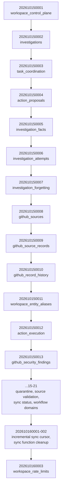

# Database design

Supabase Postgres is the **authoritative** store for everything mutable: workspace
identity and membership, investigations, current facts and fact history, task
leases/handoffs, action proposals and approvals, idempotency receipts, and audit events.
FalkorDB never gets a direct write from a request — see
`docs/Architecture/SYSTEM_ARCHITECTURE.md` for why.

## Migrations

23 migrations, applied in filename order, under `supabase/migrations/`:

One gotcha worth knowing before writing a new migration:
`CREATE OR REPLACE FUNCTION` does **not** replace a function if its parameter list
changes — Postgres silently creates a second overload and leaves the old one callable.
Changing an existing RPC's signature needs an explicit
`DROP FUNCTION IF EXISTS name(old, param, types)` in a follow-up migration first. See
`TESTING.md` §2.4 for the verification query.

## Core tables (by concern)

| Concern | Tables | Key invariant |
|---|---|---|
| Identity | `workspaces`, `workspace_members` | RLS scopes every other table through membership. |
| Investigations | `investigations`, `investigation_events` | Events are append-only; `workflow_domain` is fixed at creation, not client-overridable at run time. |
| Current facts | `investigation_facts`, `investigation_fact_versions`, `investigation_fact_candidates` | Writes require an expected version + idempotency key — stale writes get `409`, not a silent overwrite. Agent/REST submissions land in the `_candidates` table only; the direct trusted-fact RPC is revoked from authenticated clients. |
| Attempts | `investigation_attempts` | A retry after a recorded failure is rejected unless the caller supplies a changed condition snapshot, an explanation, and source-version evidence for the change. |
| Tasks | `investigation_tasks`, task leases/handoffs | Claims are exclusive with an expiring lease; only the named handoff recipient can acknowledge; an expired handoff cannot be accepted. |
| Actions | `action_proposals`, approval/execution tables | Approval is an immutable row bound to a SHA-256 content hash of the exact proposal; execution re-verifies the hash, approval age (24h), and current evidence before touching GitHub. |
| GitHub sources | `github_sources`, `github_source_records`, `github_record_history`, `github_security_findings` | Updates archive the superseded provider version rather than overwriting it; partial sync failures are recorded and surfaced, not silently dropped. |
| Aliases | `workspace_entity_aliases` | An alias only binds after its target already resolves to exactly one accessible graph entity. |
| Rate limiting | via `202610160003` | A `SECURITY DEFINER`, membership-checked RPC gates the agent-run, ask-delegation, and GitHub-sync routes. |

## Why SQLite-style "two stores" isn't the model here

Unlike a design where the graph *is* the database, Waypoint deliberately keeps Postgres
and FalkorDB in separate roles: Postgres for anything that needs transactions, RLS,
idempotent writes, and point-in-time correctness; FalkorDB for the traversal-shaped reads
that would be painful as recursive SQL. The **transactional outbox** (enqueued inside the
same Postgres transaction as the workflow write, drained by `worker:graph-projection`) is
what keeps them from drifting — a crash between "write to Postgres" and "project to graph"
leaves a replayable outbox row, never a half-applied graph state.

## Versioning and idempotency, concretely

- **Fact writes** carry an `expectedVersion`; a write against a stale version is rejected
  with `409 version_conflict` rather than silently clobbering a concurrent update.
- **Every state-changing MCP/REST call** that can be retried (tool calls, task
  transitions, proposal creation) carries an idempotency key derived from the
  operation — a byte-identical retry returns the original result; a retry with different
  input is rejected rather than silently applied twice.
- **GitHub record history**: an update to a synced commit/PR/issue archives the old
  provider version and payload before writing the new current value, so "what did this
  record look like before" is always answerable.

## What's unverified (honest status)

Everything above is implemented and passes offline contract tests
(`bun run test:contracts`, 27 scripts). What has **not** been run against a live,
remotely-hosted Supabase project in this environment: migration application at scale,
cross-workspace RLS denial under concurrent load, and a full outbox-replay/recovery
exercise. See `IMPLEMENTATION_TRACKER.md` for the authoritative, per-milestone evidence
log — don't take "the code exists" as "this is verified."
