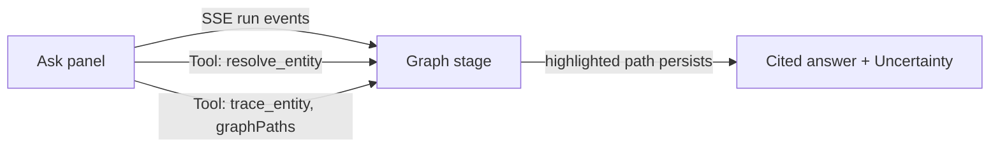

# Frontend guide

Next.js App Router, TypeScript, Tailwind. The signed-out site is an ivory/charcoal/sage
palette (`src/components/landing.tsx`); the signed-in product is a dark "mission control"
cockpit (`src/app/cockpit.css`). Icons are Lucide React; the brand mark and graph
illustrations are native CSS/SVG — no external UI CDN scripts at runtime.

## Routes

| Route | Component | Purpose |
|---|---|---|
| `/` (signed out) / `/welcome` | `src/components/landing.tsx` | Marketing/landing page: headline, three-track framing (Acts on connected data / Remembers & coordinates / Company brain), live showcase graph. |
| `/` (signed in) | `src/app/page.tsx` → Cockpit | Knowledge graph stage + docked Ask panel, Sources, Investigations as light sheets. |
| `/login` | — | Supabase-authenticated sign-in/sign-up. |
| `/setup` | — | GitHub App installation / repository connection flow. |
| `/investigations/:id` | `src/app/investigation-detail.tsx` | Full investigation record: evidence, recovery export, tasks, action proposals, raw run-trace log. |

## The Cockpit

`src/components/chat-shell.tsx` (icon rail + sheet host) wraps:

- **Knowledge graph stage** (`graph-explorer.tsx`, backed by `GET /api/graph/explore`) —
  stats HUD (entity/relationship counts, type distribution), search, node inspector, an
  explicit "Sample" toggle for the labeled synthetic demo graph. The same role-based ACL
  used by the agent's own tools applies here — this view can never show more than the
  agent itself is allowed to traverse.
- **Agent panel** (`src/app/workspace-ask-panel.tsx`) — auto-growing composer, workflow
  domain selector, threaded turns, and **live run steps**: as the agent's tool calls
  stream in (`graphPaths` on each `tool_call` trace event), the corresponding entities and
  relationships light up on the graph stage in real time and stay highlighted on the
  finished answer.



## Shared UI primitives

- `src/components/ui/button.tsx` — shadcn/ui's official Button registry source
  (`https://ui.shadcn.com/r/styles/new-york/button.json`), adapted to this project's
  semantic CSS classes; Radix `Slot` + `class-variance-authority` preserve composition and
  variant behavior.
- `src/components/ui/textarea.tsx` — shadcn/ui Textarea, same adaptation.
- `src/components/fade-content.tsx` — React Bits `FadeContent`
  (`https://reactbits.dev/r/FadeContent-TS-CSS.json`), GSAP scroll-fade mode, with
  reduced-motion support and content visible before JS initializes.
- `src/components/shiny-text.tsx` — React Bits `ShinyText`, CSS-only.
- `src/components/graph-canvas.tsx` — dependency-free interactive SVG graph renderer
  (animated edges, hover focus, zoom/pan), backed by the layout engine in
  `src/lib/graph-view.ts`. Used in three places: the reasoning-path view under a chat
  answer, the Knowledge Graph explorer, and the landing-page showcase.

## The sample graph is explicitly labeled

Owners/admins can load or remove a synthetic sample incident graph
(`POST`/`DELETE /api/graph/sample`). Every record it creates is tagged `sample: true`
with `sample:`-prefixed IDs — it exists so the product can be demonstrated before a real
source is connected, and it is never treated as evidence by the agent or presented as a
real integration.

## Build

```bash
bun install
bun run dev         # local dev server
bun run build        # production build
bun run typecheck    # tsc --noEmit
```

No Docker is required for the frontend itself (only FalkorDB needs it locally — see
`docs/Setup/SETUP_GUIDE.md`).
