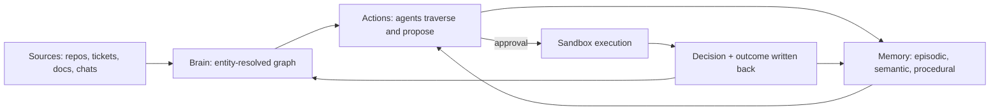

---

## 4. Validation evidence

This section separates what is **demonstrated**, what is **argued**, and what is **ours to prove**. The honest headline: *firsthand, quantified evidence for several of these pains is thin in the public record we gathered; the strongest independent proof we can produce in four days is our own benchmark (§15).* The evidence below shows the problems are real enough and recognised enough to justify building, and it shows where the design must be careful.

### 4.1 Evidence key

| Tag | Meaning |
|---|---|
| **[V\*]** | Re-verified by reading the page during this build (15 Oct 2026) |
| **[V]** | Marked *verified* in your research archive; not re-read again for this document |
| **[P]** | URL provided by you; content not inspected. Cite only after reading |
| **[S]** | Secondary, vendor or commentary; useful context, not independent proof |
| **[U]** | Contains a statistic whose methodology is unverified. Do not use the number in the pitch |

### 4.2 Pain point to evidence summary

| Pain | Strongest evidence | Type | Strength | What it proves | What it does *not* prove |
|---|---|---|---|---|---|
| P1 Amnesia | D.02 [V]; explainers D.30–D.32, D.35 [P/V] | One firsthand request plus explainers | Moderate-weak | Users hit continuity friction across devices and sessions | That amnesia is universal or quantified; D.02 was closed as not planned |
| P2 Contradictions | **D.01 [V\*]** | Firsthand design discussion with an experiment | **Strong** | Additive memories coexist; linking is not resolution; LLM judge mislabels supersession | Behaviour of other products; behaviour at 10k+ scale (not measured in the thread) |
| P3 Concurrency | D.45 [V\*], D.39 [S] | Peer-reviewed taxonomy over 1,600+ traces | Moderate (partial) | Multi-agent systems fail in recurring, classifiable ways including inter-agent misalignment | That write conflicts specifically cause X% of failures |
| P4 Isolation / poisoning | D.46, D.47 [P]; D.14 [S]; D.07 [P] | Unread papers and a secondary digest | Weak until read | Researchers and builders are working on governed shared memory | Any rate or severity |
| P5 Disconnected knowledge | Organisers' brief [V\*]; D.36–D.38, D.40–D.43 | Brief plus essays and investor thesis | Moderate | The framing is widely held, and the contest explicitly asks for it | Measured business loss |
| P6 Decision provenance | D.40 [V] | Investor thesis | Moderate | A recognised gap: outcomes are recorded, reasons are not | That customers will pay for it |
| P7 Multi-hop | Sponsor docs benchmark [S]; D.53 [P] | Vendor-reported | Moderate-weak | The vendor claims graph retrieval outperforms vector RAG on a public benchmark | Independent replication; applicability to our data |
| P8 Identity | Design necessity; related tooling [S] | Argument | Weak-moderate | Any multi-source graph needs identity resolution | Frequency of failure in agents |
| P9 Tool overload | D.34 [U], D.11 [P] | Blog with unverified percentages | Weak | A discussion exists | Any number. We test this ourselves |
| P10 Forgetting | D.29 [V], D.22 [P] | Explainers | Moderate-weak | Practitioners advocate selective forgetting | Quantified benefit |

### 4.3 Deep dive: Mem0 discussion #4787 (firsthand, re-verified)

**Source:** `https://github.com/mem0ai/mem0/discussions/4787` [V\*]. Opened 11 Apr 2026 by a developer asking how Mem0 handles deduplication, contradictions and retrieval quality at 10k+ memories per user. GitHub marks the thread *Unanswered* (no accepted answer), but contributors replied between June and July 2026.

What the thread establishes (paraphrased, not quoted):

| Observation | Source in thread | Why it matters to Waypoint |
|---|---|---|
| In the described v3 additive path, new memories are emitted as additions and may carry `linked_memory_ids` pointing at related older ones; no global deduplication pass collapses the store. | Reply of 29 Jun and 24 Jul 2026 | Confirms "keep everything, link it" is a real design choice with consequences for currency |
| Duplicate handling beyond the LLM's own skipping is an exact hash match, so slightly reworded facts usually remain separate rows. | Reply of 24 Jul 2026 | Paraphrased duplicates accumulate |
| For contradictions (Python in session 1, TypeScript in session 3) both memories stay by design; retrieval signals are expected to surface the current one. | Replies of 29 Jun and 24 Jul 2026 | Currency is left to ranking, not to a deterministic rule |
| "Linking isn't resolution": both linked memories remain independently retrievable and nothing flags the pair for review. | Reply of 19 Jul 2026 | The exact gap our SUPERSEDES chain and review queue address |
| A small external audit on a synthetic store (24 facts, 7 planted pairs: 3 duplicates, 2 contradictions, 2 supersessions, plus a trap pair and 8 noise facts) found every planted pair (recall 7/7 across runs) but labelled **both supersession pairs as contradictions** on every configuration; false positives varied by embedding model. The author states the limits: one small set, one measurement per configuration, no 10k-scale measurement. | Reply of 31 Jul 2026 | Supports using deterministic predicate rules plus human review for disputes, instead of an LLM judge for classification |
| One participant describes explicit supersession with a `superseded_by` field so queries can filter to the current belief. | Reply of 26 Jul 2026 | Independent convergence on the same pattern we propose |
| The 21 Jul reply promotes a competing product. | Reply of 21 Jul 2026 | Treat as marketing, ignore as evidence |

**Interpretation.** This is *not* evidence that Mem0 is broken. Keeping both is a documented design choice. It is evidence that **"which fact is current" is an unsolved, explicitly discussed design question**, that contributors converge on supersession as an answer, and that LLM-judged conflict typing has a reproducible failure on the supersession case in at least one small test.

**Date check.** Comment dates in the thread are mid-2026, consistent with the thread being open at the time of writing; behaviour may have changed since. We cite the thread, not the product's current code.

### 4.4 Deep dive: MAST, "Why Do Multi-Agent LLM Systems Fail?"

**Source:** `https://arxiv.org/abs/2503.13657` [V\*]. From the abstract: the authors build MAST-Data (1,600+ annotated traces across 7 popular multi-agent frameworks) and the first Multi-Agent System Failure Taxonomy, developed from 150 expert-annotated traces with inter-annotator agreement kappa = 0.88. It identifies **14 failure modes in 3 categories**: system design issues, inter-agent misalignment, task verification. The dataset, taxonomy and an LLM annotator are released.

**How we use it.** It justifies treating *coordination* and *verification* as first-class problems and gives us a vocabulary. It does **not** quantify lost updates or tenant leakage, so we do not claim it validates those; our concurrency and isolation tests (§15) produce that evidence.

### 4.5 The organisers' brief as demand evidence [V\*]

The sponsor and organiser state the problem directly: agents see pieces, lose track of earlier sessions, miss relationships, and cannot explain choices. The three tracks encode exactly the pains in §3. This is the strongest *contest-specific* signal and it is primary-source.

### 4.6 Technical feasibility proofs (FalkorDB documentation, re-verified)

These are the facts the architecture leans on. Each was read in the official docs on 15 Oct 2026 [V\*].

| Capability we rely on | What the docs say (paraphrased) | Design consequence |
|---|---|---|
| **Many isolated graphs per instance** | The sponsor page states one instance can hold thousands of isolated graphs, one per user, agent or tenant | Graph-per-tenant isolation (ADR-001) |
| **Single-query atomicity** | Any write query (CREATE, SET, DELETE, MERGE and combinations, including compound clauses) is all-or-nothing, including schema effects | Compare-and-set in one Cypher statement is safe (ADR-004) |
| **Serialised writers, parallel readers** | Per graph: many concurrent reads; one write at a time in FIFO order; readers see a snapshot from before an in-flight write | No torn reads; write throughput per tenant is bounded (benchmark it) |
| **No native multi-query transactions** | Use Redis MULTI/EXEC; note it serialises across all graphs | We avoid cross-query transactions; design idempotent single-statement writes |
| **ACL with graph patterns and R/W flags** | Users can be limited to graph key patterns (`~pattern`) with `%R~`/`%W~`/`%RW~` permissions; ACL changes persist only with an ACL file and `ACL SAVE` | Optional per-tenant database users as defence in depth (§11) |
| **Indexes** | Range, full-text (RediSearch syntax incl. prefix and fuzzy) and vector (HNSW; dimension 1–4096; cosine or euclidean) | Hybrid retrieval inside one engine |
| **Vector queries do not combine with property filters** | Listed under known gotchas | Over-fetch then filter after the call; tenant isolation avoids the need for a tenant filter (Q-03) |
| **Constraints** | Unique and mandatory constraints created with `GRAPH.CONSTRAINT CREATE`; built asynchronously; a unique constraint needs a matching range index | "No fact without a source" and unique IDs enforced by the database |
| **Algorithms** | BFS, shortest paths (SPpaths, SSpaths), PageRank, betweenness, harmonic centrality, WCC, label propagation, max flow, minimum spanning forest | Algorithms exposed as agent tool presets (service criticality, communities) |
| **Operations** | RDB/AOF persistence, per-graph DUMP/RESTORE, `GRAPH.COPY`, `GRAPH.MEMORY USAGE`, `GRAPH.EXPLAIN/PROFILE/SLOWLOG`, OpenTelemetry guide for Python | Backup, tenant export, metering and tuning paths exist |
| **Cypher subset** | OpenCypher v9 subset; no node label expressions; regex operator unsupported; `LIMIT` does not bound eager writes; relationships not referenced elsewhere in a pattern are only checked for existence | Query authors follow the cheat sheet and known-limitations page (§9.1) |
| **License** | SSPLv1: offering FalkorDB itself as a service to others triggers obligations; internal and evaluation use do not | See §12.9 before commercial launch |

### 4.7 Counter-evidence and honest skepticism

| Signal | Source | How we respond |
|---|---|---|
| Commenters question whether a new "universal memory protocol" beats plain files without measured gains | D.23 [V] | Our benchmark includes a **flat markdown-file memory baseline** and reports where it wins |
| "88% of enterprise pilots fail" | D.33 [U] | Not used anywhere |
| Tool-count degradation percentages | D.34 [U] | We measure our own 7-tool vs 25-tool ablation |
| Forecast that a large share of agentic projects may be cancelled by 2027 | D.44 [S] | Cited only as a *forecast* in context, never as fact |
| Graph built from bad extraction can be worse than text search | Archive caveat | Provenance and abstention; baseline comparison; extraction confidence thresholds |
| A relational store plus event log is enough for many tasks | Archive caveat | Section 6 states when we would *not* use a graph |

### 4.8 Validation gaps and how we close them

| Gap | Plan | When |
|---|---|---|
| D.46–D.53 papers unread | Read abstracts and results; extract any benchmark we can reuse; cite only what we read | Before blog post |
| LinkedIn and X posts gated | Do not cite content; keep as "directions to read" | Skip for submission |
| No Reddit or Instagram evidence captured | State this limitation plainly; optionally collect two or three firsthand threads | If time |
| No customer interviews | Add "talk to 5 platform engineers" to post-hackathon plan | §19.5 |
| No independent benchmark of our own | Build it (§15), publish methodology and seeds | Days 2–3 |
| Three URLs in the archive look mangled by PDF extraction | See Appendix A notes; re-copy from the source posts | Before citing |

### 4.9 Claims register (what the pitch may say)

| Claim | Allowed? | Backing |
|---|---|---|
| "Keeping both contradictory memories and linking them does not tell an agent which is current" | Yes | D.01 [V\*] |
| "An LLM judge labelled both supersession pairs as contradictions in one public test" | Yes, with the test's limits stated | D.01 [V\*] |
| "Multi-agent systems fail in 14 recurring modes across 3 categories" | Yes | D.45 [V\*] |
| "FalkorDB writes are atomic per query and serialised per graph; readers see snapshots" | Yes | FalkorDB docs [V\*] |
| "Graph retrieval beats vector RAG by X points" | **Only our own measured X** | §15 |
| "88% of pilots fail" | **No** | D.33 [U] |
| "Zero cross-tenant leakage" | Only as "0 of N attack scripts in our suite" | §15 |

---

## 5. The solution

### 5.1 Product definition

**Waypoint** is a multi-tenant SaaS that provides a **governed context graph** for AI agents:

- **Ingest** public, synthetic or customer-owned sources through connectors into an entity-resolved graph (Brain).
- **Remember** through an MCP memory service whose facts are bitemporal, supersede deterministically, and carry provenance and trust tiers (Memory).
- **Act** through approval-gated tools whose every call is justified by a graph path and recorded in the graph (Actions).
- **Explain** everything: each answer and action returns a trace that the console renders as a path.

Agents connect over **MCP** (preferred), REST, or the Python SDK. The console is for humans: ask, explore, approve, audit, administer.

### 5.2 Design principles

1. **Graph-first, not graph-only.** Use text and vector search to find *seeds*; use the graph to connect, constrain and explain. Keep a text baseline for honesty.
2. **Evidence or abstain.** No claim without a cited path; "unknown" is a valid answer.
3. **Deterministic where possible.** Currency, conflict, concurrency and authorisation are rules and constraints, not model judgement.
4. **Fail closed.** Missing ACL, missing provenance, or untrusted origin means the write is rejected or quarantined.
5. **Humans approve irreversible actions.** Risk is computed from the graph (blast radius, criticality, reversibility).
6. **Small tool surface.** Seven tools with clear contracts.
7. **Everything is a trace.** Tool calls, queries, versions, approvals and outcomes are queryable.
8. **Synthetic first.** Hackathon data is public or synthetic by rule; the design does not depend on private data to demonstrate value.

### 5.3 Capabilities and acceptance criteria

#### Brain (T3)

| ID | Capability | Acceptance criteria |
|---|---|---|
| B-1 | Connect sources and build the graph | Given a GitHub public repo and a synthetic Slack/doc export, when ingestion completes, then Person, Team, Service, Ticket, PullRequest, Document and Message nodes exist with provenance edges, and re-ingesting unchanged inputs creates no duplicates |
| B-2 | Entity resolution | Given the same person under three aliases, then one canonical Person exists with alias edges and confidence; given two distinct people with one name, then they are not merged; merges are reversible |
| B-3 | "Ask the company" | Given a multi-hop question, then the answer lists evidence paths, each claim cites a path ID, and removing the graph from retrieval measurably lowers accuracy |
| B-4 | Decision provenance | Given a Decision with documented rationale, then the UI shows decider, date, alternatives and evidence; given none, then the answer says "rationale not documented" and lists leads labelled as non-rationale |
| B-5 | Freshness | Given a changed artifact, then derived edges no longer asserted are end-dated, not deleted; "as of" queries return the earlier state |
| B-6 | Permissioned answers | Given a principal without access to a node, then no path through that node appears, and no answer text derived from it is produced |

#### Memory (T2)

| ID | Capability | Acceptance criteria |
|---|---|---|
| M-1 | Episodic log | Events are appended idempotently by `op_id`; replaying the same op creates nothing new |
| M-2 | Semantic facts, bitemporal | Each fact has `valid_from/valid_to` and `recorded_at`; recall at time T returns what was true at T |
| M-3 | Deterministic supersession | A new value for a functional predicate retires the old fact and links `SUPERSEDES`; same value corroborates; cardinality-many predicates add |
| M-4 | Disputes | A lower-trust conflicting write becomes `disputed`, appears in the review queue, and never silently replaces the current fact |
| M-5 | Procedural memory | A successful approved action updates a Procedure's success counters; the next agent can recall the procedure |
| M-6 | Concurrency | 50 workers each performing 20 compare-and-set updates produce zero lost updates; stale writes receive `409 version_conflict` |
| M-7 | Handoffs | A handoff is offered, acknowledged or expired; unacknowledged handoffs revert after the lease |
| M-8 | Tenant isolation | Cross-tenant access attempts (API, MCP, injected graph names) all fail |
| M-9 | Quarantine | Writes with `trust=untrusted` are excluded from default recall and cannot justify an action |
| M-10 | Forgetting | `forget` tombstones the node and every `DERIVED_FROM` descendant and removes content properties; the audit record shows hash and time only |

#### Actions (T1)

| ID | Capability | Acceptance criteria |
|---|---|---|
| A-1 | Investigate | Given an incident on service X, the agent uses at most 12 tool calls to produce: blast radius, criticality ranking, recent upstream changes, owner and on-call |
| A-2 | Propose | A proposed action cites at least one trusted evidence path; proposals without evidence are rejected |
| A-3 | Gate | High-risk actions require approval; the approval modal shows risk factors and evidence path |
| A-4 | Execute safely | Execution happens only through a sandbox adapter; no real third-party side effects in the hackathon |
| A-5 | Explain | `explain(action_id)` returns the full tool-call trace and the supporting path |
| A-6 | Learn | Approved outcomes write a Decision and update procedural memory |

### 5.4 Feature priorities

| Priority | Features |
|---|---|
| **P0 (must ship)** | Graph-per-tenant provisioning; seeded demo company; public GitHub connector; entity resolution (rule-based with confidence); Brain ask with evidence paths and abstention; memory remember/recall with supersession, CAS and quarantine; tasks with claim and handoff; incident agent with approval and sandbox; seven MCP tools; console pages Ask, Graph, Memory, Incidents, Approvals, Eval; benchmark with graph on/off; README, queries, data model, video, deploy or local setup |
| **P1 (should)** | Stripe-style metering (counted, not billed); API keys UI; per-tenant ACL users in FalkorDB; as-of time slider; entity merge/split UI; forgetting propagation demo; audit log page |
| **P2 (stretch)** | Slack bot front-end; webhook change-data ingestion; tenant hibernation via DUMP/RESTORE; SSO; second sandbox adapter; PageRank/betweenness dashboards |
| **Cut first** | Real billing, real third-party connectors beyond GitHub, mobile layout, i18n, SOC 2 controls |

### 5.5 Non-goals (for now)

Training models; replacing the customer's system of record; storing private or personal data during the hackathon; real production side effects; claiming compliance certification.

### 5.6 Key user journeys

1. **Onboard.** Sign up → create workspace → provision graph → "Load demo company" or connect public repo → see node/edge counts and first question suggestions.
2. **Ask.** Type "Why was the payments migration delayed and who can unblock it?" → streamed answer → click a citation → path highlights on canvas → inspect source artifact.
3. **Incident.** Alert arrives for `checkout-api` → agent runs → timeline shows each tool call → approval card with blast radius and evidence → approve → sandbox executes → outcome becomes a Decision.
4. **Memory.** Change a fact ("owner of `ledger` is now Team Atlas") → old fact superseded with a visible chain → two agents race → one gets a version conflict and retries → a second tenant cannot read.
5. **Prove it.** Open Eval → toggle graph off → same questions fail → scoreboard shows the delta with baselines and failure cases.

### 5.7 The feedback loop



---

## 6. Why this is the best approach

### 6.1 Decision criteria

We judge approaches against the six root problems plus build-ability in four days: (1) multi-hop connected retrieval, (2) deterministic currency of facts, (3) coordination safety, (4) isolation and governance, (5) explainability, (6) fit with the hackathon rules and prize criteria, (7) engineering risk within the window.

### 6.2 Alternatives compared

| Approach | Strengths | Weaknesses against our criteria | Verdict |
|---|---|---|---|
| **Replay long chat history / big context windows** | Zero infrastructure | Cost and latency grow; no structure; no cross-agent sharing; no currency rules | Baseline only |
| **Vector RAG (with rerank)** | Simple; good at "find similar text" | Nearest text is not connected evidence; no versioning or supersession; weak provenance | Used for *seed finding*, not as the system |
| **Flat file memory (markdown notes)** | Transparent, diffable, cheap; HN commenters argue it is often enough (D.23) | No concurrency control, no multi-hop, no tenant isolation, manual currency | **Kept as a benchmark baseline** and as an export format |
| **Relational DB + pgvector + event log** | Mature, transactional, familiar; handles much of memory and authz | Multi-hop and path queries become recursive joins; path explanation is awkward; no graph algorithms as tools | Used for the **control plane** (tenants, billing), not for context |
| **Add-only memory services (Mem0-style)** | Fast to adopt; managed | Per D.01, currency of facts is left to retrieval ranking; dispute handling is external | We borrow the idea of extraction, replace the currency model |
| **Temporal knowledge-graph memory libraries (e.g., Graphiti, Cognee)** | Graph-native, time-aware; listed by the sponsor as integrations | We have not audited them; Waypoint adds governance, action gating, handoffs, tenant model and an eval harness on top of a graph | Potential components; we write our own thin layer to control schema |
| **Framework checkpointers (e.g., LangGraph persistence)** | Excellent for one framework's run state | Framework-scoped; not a cross-agent, cross-source context layer | Complementary |
| **Enterprise search with knowledge graph (commercial)** | Mature connectors | We have not audited; typically read-only search rather than agent memory and action governance | Out of scope to compete on connectors |
| **Waypoint: governed context graph on FalkorDB** | Connected retrieval; deterministic currency; CAS and leases; isolation; evidence paths; algorithms as tools; one engine for graph, full-text and vector | Extraction quality risk; per-graph write serialisation; in-memory cost; connector effort | **Chosen** |

### 6.3 Where a graph wins and where it does not

| A graph clearly helps | A graph is unnecessary or worse |
|---|---|
| Questions that traverse 3+ typed relationships (who owns what depends on what) | Single-document lookup or FAQ-style search |
| Showing *why* via a path, with per-edge provenance | Pure similarity browsing |
| Supersession chains, bitemporal history, decision lineage | Small stable personal notes (a file is fine) |
| Impact analysis, shortest path, centrality, communities as tools | Tabular aggregates (a warehouse is better) |
| Per-tenant isolated memory with explicit sharing edges | Single-user, single-agent scratchpad |

We say so in the pitch. Credibility comes from a benchmark where the graph is allowed to lose.

### 6.4 Why FalkorDB specifically

All items below are from the official docs and sponsor page read on 15 Oct 2026 (§4.6) unless marked.

1. **Multi-graph topology** gives tenant isolation as a data-model property: one graph per tenant, thousands per instance.
2. **Atomic single-query writes and per-graph serialised writers** make compare-and-set and idempotent upserts safe with no external lock service.
3. **Snapshot-style reads** mean agents never observe half-applied handoffs or supersessions.
4. **Graph, full-text and vector indexes in one engine** let us do hybrid seed retrieval and traversal in a single round trip pattern.
5. **Built-in algorithms** (PageRank, shortest path, centrality, communities, max flow) can be exposed as tool presets instead of agents writing algorithms.
6. **Redis protocol and official Python/Node clients**; Docker image for local runs; FalkorDB Cloud accepted by the rules.
7. **Mandatory and unique constraints** enforce "no fact without source" in the database.
8. **ACL graph permissions** provide defence in depth.
9. **Operational hooks** for metering and tenancy lifecycle (`GRAPH.MEMORY USAGE`, `GRAPH.COPY`, DUMP/RESTORE, `GRAPH.DELETE`).

Trade-offs we accept: Cypher subset (check limitations before use), write throughput bounded per graph (mitigated by batching and by separate graphs), memory-resident data (cost model in §12.8), SSPL licensing (§12.9).

### 6.5 Hybrid retrieval, not graph worship

```
question ──► seed finding (alias match → full-text → vector over chunks, ACL post-filter)
        ──► bounded graph expansion (typed edges, per-hop ACL, temporal filter)
        ──► path scoring (confidence × freshness × trust × 1/hops)
        ──► evidence assembly (edge provenance + excerpts)
        ──► constrained generation (claims must cite paths) ──► verifier ──► answer | "unknown"
```

### 6.6 How we will *prove* it is better

| Claim | Test | Pass criterion (hypothesis; report actuals) |
|---|---|---|
| Graph helps multi-hop | 20 questions needing 3–5 hops, graph vs vector+rerank baseline | Graph correct ≥ 20 points higher; failure cases listed |
| Deterministic currency beats judge | 10 supersession and 10 contradiction cases | ≥ 95% correct current-fact answers on rule-decidable cases; disputes surfaced |
| CAS prevents lost updates | 50 workers × 20 updates | 0 lost updates; stale writes return 409 |
| Isolation holds | ≥ 50 attack scripts across API, MCP, graph-name injection, per-hop ACL | 0 leaks, reported as "0 of N" |
| Provenance coverage | Audit all claims in 60 answers | ≥ 95% of claims map to a path |
| Abstention works | 10 questions whose rationale is undocumented | ≤ 5% fabricated rationales |
| Small tool set helps | 7 tools vs 25 overlapping tools on the same tasks | Report selection errors; no prior claim |
| Memory beats flat files | Same tasks with markdown-file memory | Report where files win |

### 6.7 Risks inherent in the approach

| Risk | Mitigation |
|---|---|
| LLM extraction errors poison the graph | Confidence thresholds; quarantine low confidence; deterministic seed data for the core demo; every edge carries source |
| Entity merges are wrong | Confidence bands; review queue; merge is reversible with a stored undo record |
| ACL filtering on variable-length paths leaks or hides | App-side frontier expansion with per-hop filter for non-admins; leakage tests (§11.4) |
| Write serialisation limits throughput | Batch with `UNWIND`; separate graphs per tenant; measure writes/sec in §15 |
| In-memory cost | Tenant limits; hibernation roadmap |
| Over-engineering for four days | P0/P1/P2 scoping; cut list; freeze time |

