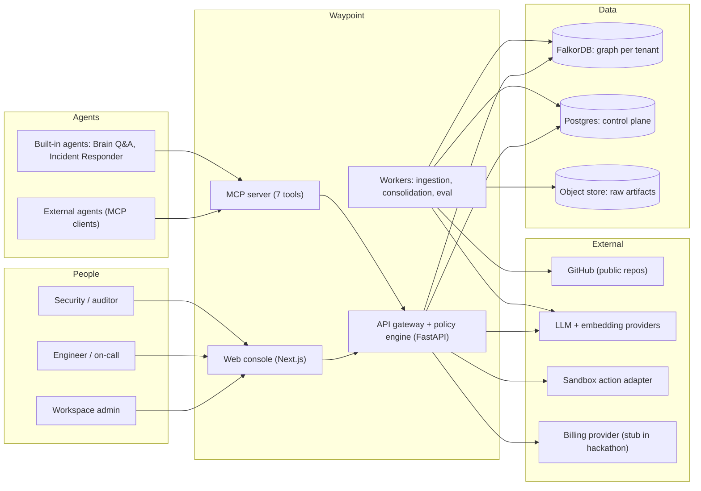
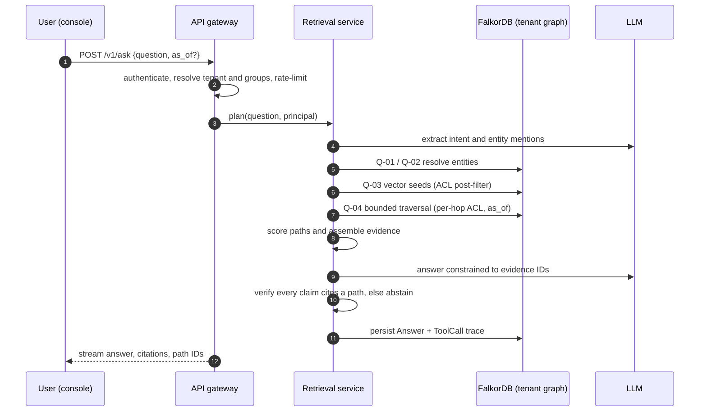
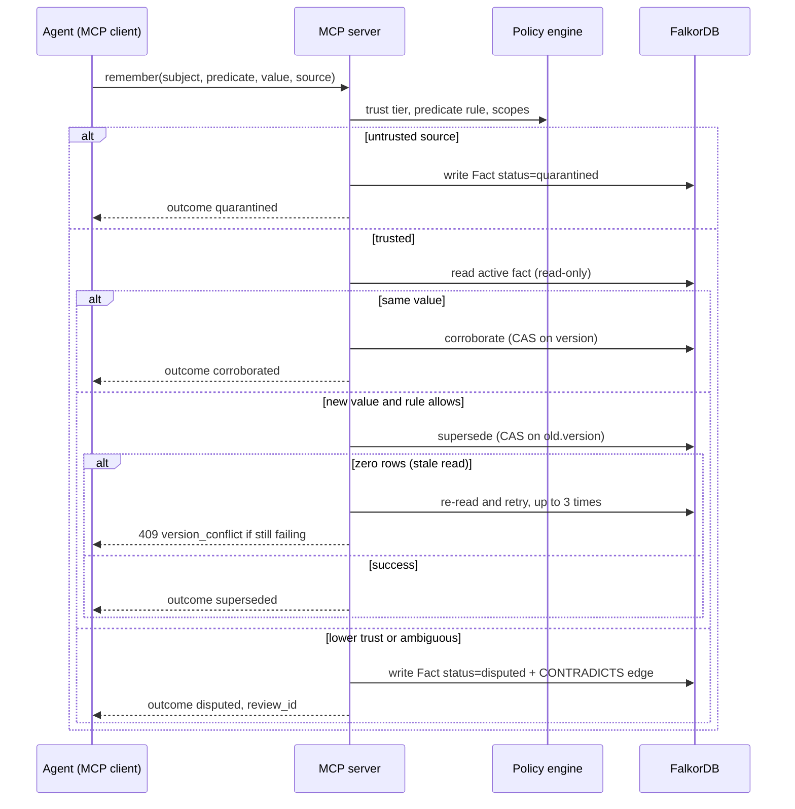
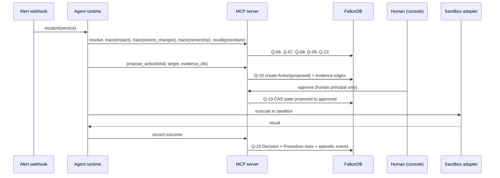
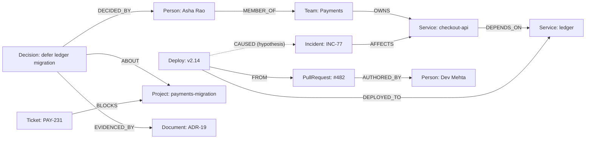

---

## 7. System architecture

### 7.1 Architecture in one paragraph

Waypoint is a **modular monolith** (one FastAPI application with clean module boundaries and a background worker) in front of **FalkorDB** (one graph per tenant) and **Postgres** (control plane). Agents reach it through an **MCP server** mounted in the same process; humans use a **Next.js console**. A **policy engine** sits between every caller and every graph query: it resolves the tenant, the principal's groups and scopes, trust tiers and rate limits, and it is the only code allowed to talk to FalkorDB. A modular monolith is the right shape for a four-day build (ADR-006); the module boundaries below allow later extraction into services.

### 7.2 System context



### 7.3 Components and responsibilities

| Module | Responsibility | Key rules |
|---|---|---|
| **API gateway** | AuthN (session cookie or API key), tenant resolution, rate limiting, idempotency, request logging, error mapping (RFC 9457 problem+json) | Never accepts a graph name from a client. Tenant comes from the credential only |
| **Policy engine** | Builds a `Principal` (tenant, subject, groups, scopes, trust tier); decides allow/deny per tool and per write; injects ACL parameters into every query template | Fail closed; every query goes through it |
| **Graph access layer** | The only FalkorDB client. Registry of parameterised query templates with IDs (Q-xx); timeouts; read-only vs write routing; metrics; trace recording | No string-concatenated Cypher; whitelisted fragments only (§9.1) |
| **Identity resolver** | Alias normalisation, candidate generation (exact, full-text, fuzzy), confidence banding, merge/split with undo | Auto-link ≥ 0.92; review 0.75–0.92; new entity < 0.75 (thresholds are hypotheses; tune on seed data) |
| **Ingestion pipeline** | Connector → normalise → chunk → extract (LLM structured output against the ontology) → resolve → idempotent MERGE writes → embeddings → change events | Idempotent by artifact hash; retire (end-date) edges no longer asserted |
| **Retrieval service (Brain)** | Seed finding, bounded traversal, path scoring, evidence assembly, constrained answer generation, citation verification, abstention | Every claim cites a path ID or the answer abstains |
| **Memory manager** | `remember`, `recall`, `forget`, consolidation, predicate rules, trust tiers, quarantine, disputes | Deterministic supersession (§10.4) |
| **Coordination service** | Tasks, leases, claims, handoffs, acknowledgements, expiry sweeps | CAS on `version`; idempotency via `op_id` |
| **Action service** | Propose, risk scoring, approval state machine, sandbox execution, outcome write-back | Humans approve; agents cannot approve; no evidence means no proposal |
| **MCP server** | Seven tools exposed over streamable HTTP; each tool maps to one service method | Same auth and policy as REST |
| **Agent runtime** | Planner loop for Brain Q&A and Incident Responder; step and token budgets; guardrails | Uses the MCP tools it exposes (dogfooding) |
| **Eval harness** | Dataset loader, baselines (vector+rerank, flat file), ablation switches, scoring, reports | Separate module and CLI; never used by product paths |
| **Metering** | Counts reads, writes, tokens, storage; emits `usage_events` | Eventual consistency is fine here |
| **Console** | Ask, Graph, Memory, Agents, Incidents, Approvals, Connectors, Eval, Settings | Thin client over REST + SSE |

### 7.4 Key flows

#### 7.4.1 Ask (Brain)



#### 7.4.2 Remember with a conflict (Memory)



#### 7.4.3 Incident to approved action (Actions)



### 7.5 Technology stack

| Layer | Hackathon default | Why | Alternatives |
|---|---|---|---|
| Language (backend) | Python 3.12 | Official FalkorDB client; MCP SDK; fast iteration; LLM ecosystem | Node/TypeScript (official client exists) |
| API framework | FastAPI + Pydantic v2 | Typed models, OpenAPI for free, SSE support | Litestar, Express/Fastify |
| MCP | Official Python MCP SDK (FastMCP), streamable HTTP transport | Standard tool interface; sponsor page lists MCP among supported stacks | Node MCP SDK |
| Graph DB | FalkorDB (Docker for dev; FalkorDB Cloud or self-hosted for demo) | Required by rules | — |
| Control plane DB | Postgres (Neon/Supabase/Railway) | Tenants, keys, billing, audit; boring and reliable | SQLite for pure local dev |
| Queue | Postgres-backed jobs table or in-process worker | Fewest moving parts in four days | RQ/arq with a *separate* Redis |
| LLM | Pluggable via env (`LLM_MODEL`); Anthropic or any provider through a thin adapter | Avoid lock-in; the extraction and answer prompts are model-agnostic | LiteLLM |
| Embeddings | Pluggable (`EMBED_MODEL`, `EMBED_DIM`) | Dimension must match the vector index (1–4096) | Local sentence-transformers |
| Fuzzy matching | `rapidfuzz` (Python) | Alias scoring app-side | FalkorDB FLEX UDFs (Jaro-Winkler, Levenshtein) if enabled |
| Frontend | Next.js (App Router), TypeScript, Tailwind, shadcn/ui, TanStack Query | Fast UI assembly | Vite + React |
| Graph canvas | Cytoscape.js or react-force-graph-2d | Path highlighting, filtering | Sigma.js |
| Auth | Auth.js (OAuth) or Clerk for humans; hashed API keys for agents | Avoid building login | Supabase Auth |
| Billing | Stripe test mode (metering stubbed) | Shows SaaS completeness | Lago, Orb |
| Deployment | Vercel (web), Railway or Fly.io (API, Postgres), FalkorDB Cloud or Railway template | Rules accept any platform; FalkorDB documents a Railway path | Render, Cloud Run |
| Observability | Structured JSON logs, OpenTelemetry traces, Prometheus metrics | FalkorDB documents OTel for Python | Honeycomb, Grafana Cloud |
| CI | GitHub Actions: lint, type-check, unit, integration against a FalkorDB service container | Required for confidence | — |

### 7.6 Deployment topologies

#### Local (also the fallback "complete local setup" for the submission)

```yaml
# docker-compose.yml (local)
services:
  falkordb:
    image: falkordb/falkordb:latest          # server + Browser UI (ports 6379, 3000)
    ports: ["6379:6379", "3000:3000"]
    environment:
      - REDIS_ARGS=--requirepass ${FALKORDB_PASSWORD:-falkordb} --appendonly yes
      - FALKORDB_ARGS=THREAD_COUNT 4
    volumes: ["falkordb_data:/var/lib/falkordb/data"]   # verify data dir, see note
    healthcheck:
      test: ["CMD", "redis-cli", "-a", "${FALKORDB_PASSWORD:-falkordb}", "ping"]
      interval: 10s
      timeout: 5s
      retries: 5
  postgres:
    image: postgres:16
    environment: { POSTGRES_PASSWORD: waypoint, POSTGRES_DB: waypoint }
    ports: ["5432:5432"]
    volumes: ["pg_data:/var/lib/postgresql/data"]
  api:
    build: ./apps/api
    env_file: .env
    depends_on: [falkordb, postgres]
    ports: ["8000:8000"]
  web:
    build: ./apps/web
    env_file: .env
    depends_on: [api]
    ports: ["3001:3000"]          # 3000 is taken by the FalkorDB Browser
volumes: { falkordb_data: {}, pg_data: {} }
```

> **Note on the data directory.** The FalkorDB docs show `/data` in some Compose examples and `/var/lib/falkordb/data` in the FAQ. Confirm in your container with `redis-cli CONFIG GET dir` before relying on persistence. For production prefer the `falkordb/falkordb-server` image; the docs recommend pinning an image tag rather than `latest`.

#### Demo (what judges open)

```
Browser ──► Vercel (web) ──► Railway/Fly (api + worker) ──► FalkorDB Cloud or Railway-hosted FalkorDB
                                              └──────────► Postgres (managed)
```

A live deployment is preferred by the organisers. If it cannot be deployed, the submission needs complete local setup instructions *and* a working demo video, so keep `make demo` one command.

#### Production sketch (post-hackathon)

Multi-AZ API behind a load balancer; FalkorDB primary with replicas (route read-your-writes-sensitive reads to the primary); per-region tenant placement; encrypted volumes; secrets in a manager; private networking to the database; backups via RDB/AOF plus scheduled per-graph DUMP; tenant hibernation (DUMP then `GRAPH.DELETE`, restore on first request) to control RAM cost.

### 7.7 Configuration reference (environment variables)

| Variable | Example | Purpose |
|---|---|---|
| `FALKORDB_HOST`, `FALKORDB_PORT` | `localhost`, `6379` | Connection |
| `FALKORDB_PASSWORD` | secret | `requirepass` value |
| `DATABASE_URL` | `postgresql+psycopg://...` | Control plane |
| `LLM_PROVIDER`, `LLM_MODEL`, `LLM_API_KEY` | `anthropic`, model id, secret | Extraction, answers, agents |
| `EMBED_MODEL`, `EMBED_DIM` | model id, `768` | Must match the vector index dimension |
| `API_KEY_PEPPER` | secret | HMAC pepper for API key hashes |
| `SESSION_SECRET` | secret | Console sessions |
| `PUBLIC_BASE_URL` | `https://api.example.com` | Links, CORS, MCP URL |
| `SANDBOX_MODE` | `true` | Forces sandbox adapters; refuses real side effects |
| `GITHUB_TOKEN` | optional | Higher rate limits for public-repo reads only |
| `MAX_AGENT_STEPS`, `MAX_TOOL_CALLS` | `12`, `12` | Agent budgets |
| `RATE_LIMIT_RPM` | `120` | Per principal |
| `OTEL_EXPORTER_OTLP_ENDPOINT` | URL | Traces |
| `LOG_LEVEL` | `info` | Logging |

### 7.8 Non-functional targets

Targets are **hypotheses to measure**, not promises.

| Area | Target | How measured |
|---|---|---|
| `recall` latency | p95 < 100 ms on a graph with 10k facts | Eval harness, §15 |
| `trace` (bounded, ≤ 4 hops) latency | p95 < 250 ms on a 10k-node graph | Eval harness |
| Ingestion throughput | ≥ 1,000 small artifacts per minute per tenant on one worker | Seed loader timing |
| Writes per tenant | Report measured writes/sec under contention | Concurrency test |
| Availability (demo) | Best effort; record a fallback video | — |
| Data loss | None on container restart (AOF enabled) | Restart test |
| Isolation | 0 leaks across the attack suite | Security tests |

### 7.9 Observability

- **Tracing:** every request gets a `trace_id`; every graph query records template ID, parameter hash, duration, row count. The console's trace view is built from this data.
- **Metrics:** request rate/latency, tool call counts, CAS conflicts, quarantined writes, abstentions, FalkorDB `GRAPH.SLOWLOG` snapshot, `GRAPH.MEMORY USAGE` per tenant.
- **Logs:** JSON with `tenant_id`, `principal_id`, `trace_id`; never log prompts containing tenant content at info level; redact secrets.
- **Alerts (post-hackathon):** error rate, conflict spikes, slow queries, memory per tenant approaching plan cap.

---

## 8. Data architecture

### 8.1 Tenancy model

- **One FalkorDB graph per tenant**, named `wp_<tenant_ulid_lowercase>`. The name is derived server-side from the authenticated tenant and validated against `^wp_[a-z0-9]{26}$`.
- **Defence in depth (P1):** one FalkorDB ACL user per tenant limited to that graph key (`~wp_<id>`) with only the graph commands we use; the API uses that credential for the tenant's requests. ACL users persist across restarts only with an ACL file and `ACL SAVE`.
- **Within a tenant:** `acl_groups` on every node and edge control who can see what. Group `*` means the whole workspace.
- **Control-plane metadata** (accounts, keys, billing, audit) lives in Postgres, never in a tenant graph.

### 8.2 Graph schema

Conventions: IDs are prefixed ULIDs (`ent_`, `art_`, `fct_`, `dec_`, `evt_`, `tsk_`, `act_`, `agt_`, `ses_`). Times are **UTC epoch milliseconds (integers)**, matching `timestamp()`. A missing `valid_to` means "still true". Every node has `acl_groups` (list of strings), enforced by a mandatory constraint.

#### Node labels

Nodes carry a **base label** (for identity and uniqueness) plus an optional **subtype label** (for clean patterns). Queries use the subtype label where possible.

| Label (base + subtype) | Purpose | Key properties |
|---|---|---|
| `Entity` + `Person` | A human | `id`, `name`, `email_hash` (synthetic), `status` (`active`/`merged`/`tombstoned`), `acl_groups` |
| `Entity` + `Team` | A group of people | `id`, `name` |
| `Entity` + `Service` | A software service | `id`, `name`, `tier`, `repo` |
| `Entity` + `Project` | A body of work | `id`, `name`, `status`, `target_date` |
| `Entity` + `Customer` (optional) | An external party | `id`, `name` |
| `Alias` | A surface form of an entity name | `text`, `norm`, `source` |
| `Artifact` + `Ticket` | Issue or ticket | `id`, `uri`, `title`, `status`, `priority`, `hash`, `version`, `created_at` |
| `Artifact` + `Document` | Design doc, ADR, runbook, wiki page | `id`, `uri`, `title`, `hash`, `version` |
| `Artifact` + `Message` | Chat message or thread | `id`, `channel`, `thread_id`, `ts` |
| `Artifact` + `PullRequest` | Code change | `id`, `uri`, `title`, `state`, `merged_at` |
| `Artifact` + `Deploy` | Deployment event | `id`, `ts`, `version`, `env`, `status` |
| `Artifact` + `Incident` | Operational incident | `id`, `severity`, `opened_at`, `state` |
| `Chunk` | Text fragment with embedding | `id`, `text`, `ord`, `embedding` (vecf32), `acl_groups` |
| `Decision` | A recorded decision | `id`, `title`, `decided_at`, `status`, `rationale_status` (`documented`/`inferred`/`unknown`), `rationale`, `rationale_embedding` |
| `Fact` | Bitemporal semantic memory | `id`, `sp_key`, `predicate`, `value`, `status`, `trust`, `conf`, `src`, `valid_from`, `valid_to`, `recorded_at`, `retired_at`, `version`, `support_count`, `op_id` |
| `Event` | Episodic memory item | `id`, `op_id`, `kind`, `agent_id`, `session_id`, `ts`, `payload`, `seq` |
| `Session` | One agent run | `id`, `agent_id`, `started_at`, `ended_at` |
| `Agent` | Registered agent identity | `id`, `name`, `kind`, `trust_tier`, `scopes` |
| `Task` | Shared work item | `id`, `title`, `state`, `owner`, `pending_owner`, `lease_until`, `version` |
| `Handoff` | Offer/ack record | `id`, `state`, `summary`, `created_at`, `acked_at`, `expires_at` |
| `Procedure` + `Step` | Procedural memory | `id`, `name`, `trigger`, `success_count`, `fail_count`, `version`; step `n`, `tool`, `args_template` |
| `Action` | Proposed or executed action | `id`, `kind`, `target`, `args`, `state`, `risk`, `risk_factors`, `version`, `created_at`, `approved_at`, `finished_at`, `result` |
| `ToolCall` / `Answer` | Trace records | `id`, `trace_id`, `tool`, `template_id`, `params_hash`, `row_count`, `duration_ms`; answer: `question_hash`, `paths` |
| `Tombstone` | Deletion record | `id`, `kind`, `deleted_at`, `content_hash`, `reason` |
| `MergeOp` | Undo record for entity merges | `id`, `keep`, `drop`, `at`, `undo` |

#### Relationship catalog

**Knowledge-bearing edges** (marked ★) must carry `src` (source artifact or event ID); a mandatory constraint enforces it. All edges may carry `captured_at`, `valid_from`, `valid_to`, `conf` (0–1), `method` (`connector`/`rule`/`llm`/`manual`) and `acl_groups`.

| Type | From → To | Notes |
|---|---|---|
| `MEMBER_OF` ★ | Person → Team | Time-bounded |
| `OWNS` ★ | Team → Service/Project | Time-bounded ownership |
| `ON_CALL` ★ | Team → Person | Rotation windows |
| `DEPENDS_ON` ★ | Service → Service | Dependent → dependency |
| `DEPLOYED_TO` | Deploy → Service | |
| `FROM` | Deploy → PullRequest | |
| `AUTHORED_BY` | Artifact → Person | |
| `ASSIGNED_TO` | Ticket → Person | |
| `BLOCKS` ★ | Ticket → Project/Ticket | |
| `REFERENCES` | Artifact → Artifact/Entity | Links between sources |
| `MENTIONS` | Chunk/Artifact → Entity | Extraction output |
| `PART_OF` | Chunk → Artifact | |
| `ALIAS_OF` ★ | Alias → Entity | `conf`, `method` |
| `CANDIDATE_MATCH` | Entity → Entity | Pending review, `conf` |
| `MERGED_INTO` | Entity → Entity | Set by merge; reversible via `MergeOp` |
| `AFFECTS` ★ | Incident → Service | |
| `CAUSED` ★ | Deploy → Incident | Hypotheses flagged `method:'llm'` and low `conf` |
| `RUNBOOK_FOR` | Document → Service | |
| `ABOUT` ★ | Decision → Entity | |
| `DECIDED_BY` ★ | Decision → Person | |
| `EVIDENCED_BY` ★ | Decision/Action/Fact → Artifact/Event | `role`: `rationale`, `alternative`, `outcome`, `trigger` |
| `SUPERSEDES` ★ | Fact → Fact; Decision → Decision; Artifact(version) → Artifact | New points to old |
| `CONTRADICTS` ★ | Fact → Fact | Disputes |
| `SUPPORTS` ★ | Artifact/Event → Fact | Corroboration |
| `DERIVED_FROM` ★ | Fact → Event/Artifact/Fact | Used for deletion propagation |
| `HAS_FACT` | Entity → Fact | |
| `RAN` / `HAS_EVENT` | Agent → Session; Session → Event | `seq` on `HAS_EVENT` |
| `PROPOSED_BY` / `APPROVED_BY` | Action → Agent / Person | Approval is human only |
| `TARGETS` | Action → Entity | |
| `EXECUTED_AS` | Decision → Action | |
| `INSTANCE_OF` / `HAS_STEP` | Action → Procedure; Procedure → Step | Procedural memory |
| `HANDOFF` | Task → Handoff | With `FROM_AGENT`, `TO_AGENT` edges to Agent |

#### Illustrative subgraph (demo company)



### 8.3 Bitemporal model and status rules

| Property | Meaning |
|---|---|
| `valid_from`, `valid_to` | When the fact was true *in the world* |
| `recorded_at`, `retired_at` | When the system learned it and when it stopped treating it as current |
| `status` | `active`, `superseded`, `disputed`, `quarantined`, `tombstoned` |
| `version` | Monotonic integer for compare-and-set |

Rules: exactly one `active` fact per (`subject`, `predicate`) for predicates with cardinality `one`; supersession sets the old fact `superseded`, closes its `valid_to` at the new fact's `valid_from`, and links `SUPERSEDES`. *As of T* means `valid_from <= T < valid_to` (open-ended when `valid_to` is absent). Retention never deletes history silently; deletion uses tombstones (§10.6).

### 8.4 Provisioning script (run once per tenant graph)

Constraints require a matching range index first, and constraints build **asynchronously** (status `PENDING` → `UNDER CONSTRUCTION` → `OPERATIONAL`, or `FAILED` if existing data conflicts). Create them on an empty graph.

```cypher
// Range indexes (also prerequisites for constraints)
CREATE INDEX FOR (n:Entity) ON (n.id)
CREATE INDEX FOR (n:Artifact) ON (n.id)
CREATE INDEX FOR (n:Decision) ON (n.id)
CREATE INDEX FOR (n:Fact) ON (n.id)
CREATE INDEX FOR (n:Fact) ON (n.sp_key)
CREATE INDEX FOR (n:Fact) ON (n.op_id)
CREATE INDEX FOR (n:Event) ON (n.op_id)
CREATE INDEX FOR (n:Task) ON (n.id)
CREATE INDEX FOR (n:Action) ON (n.id)
CREATE INDEX FOR (n:Agent) ON (n.id)
CREATE INDEX FOR (n:Session) ON (n.id)
CREATE INDEX FOR (n:Chunk) ON (n.id)
CREATE INDEX FOR (n:Alias) ON (n.norm)
CREATE INDEX FOR (n:Deploy) ON (n.ts)

// Full-text and vector indexes
CREATE FULLTEXT INDEX FOR (n:Alias) ON (n.text)
CREATE FULLTEXT INDEX FOR (n:Artifact) ON (n.title)
CREATE VECTOR INDEX FOR (c:Chunk) ON (c.embedding)
  OPTIONS {dimension: 768, similarityFunction: 'cosine'}       // set to EMBED_DIM
CREATE VECTOR INDEX FOR (d:Decision) ON (d.rationale_embedding)
  OPTIONS {dimension: 768, similarityFunction: 'cosine'}
```

```bash
# Constraints are Redis commands, one per rule (replace GRAPH with wp_<tenant>)
GRAPH.CONSTRAINT CREATE GRAPH UNIQUE NODE Entity    PROPERTIES 1 id
GRAPH.CONSTRAINT CREATE GRAPH UNIQUE NODE Artifact  PROPERTIES 1 id
GRAPH.CONSTRAINT CREATE GRAPH UNIQUE NODE Decision  PROPERTIES 1 id
GRAPH.CONSTRAINT CREATE GRAPH UNIQUE NODE Fact      PROPERTIES 1 id
GRAPH.CONSTRAINT CREATE GRAPH UNIQUE NODE Event     PROPERTIES 1 op_id
GRAPH.CONSTRAINT CREATE GRAPH UNIQUE NODE Task      PROPERTIES 1 id
GRAPH.CONSTRAINT CREATE GRAPH UNIQUE NODE Action    PROPERTIES 1 id
GRAPH.CONSTRAINT CREATE GRAPH MANDATORY NODE Entity   PROPERTIES 1 acl_groups
GRAPH.CONSTRAINT CREATE GRAPH MANDATORY NODE Artifact PROPERTIES 1 acl_groups
GRAPH.CONSTRAINT CREATE GRAPH MANDATORY NODE Fact     PROPERTIES 1 acl_groups
GRAPH.CONSTRAINT CREATE GRAPH MANDATORY NODE Fact     PROPERTIES 1 src
# Relationship constraints ("no knowledge-bearing edge without a source"):
GRAPH.CONSTRAINT CREATE GRAPH MANDATORY RELATIONSHIP OWNS       PROPERTIES 1 src
GRAPH.CONSTRAINT CREATE GRAPH MANDATORY RELATIONSHIP DEPENDS_ON PROPERTIES 1 src
# ...repeat for every ★ edge type. Confirm the exact relationship syntax in the
# GRAPH.CONSTRAINT CREATE docs page before scripting.
```

Check state with `CALL db.constraints()` and `CALL db.indexes()`. The provisioning job must wait for `OPERATIONAL` before the tenant is marked ready.

### 8.5 Predicate registry (semantic memory ontology)

Stored per tenant in Postgres (`predicate_defs`) and cached in the memory manager.

| Field | Meaning |
|---|---|
| `name` | e.g. `owner_of`, `preferred_language`, `on_call_for`, `status_of` |
| `cardinality` | `one` (functional: at most one current value) or `many` |
| `supersede_policy` | `newer_wins` (default), `higher_trust_wins`, `review_always` |
| `requires_review` | Always route changes to the review queue (e.g., access-control facts) |

Free-text memories that cannot be parsed into a registered predicate are stored as `Event` plus an unstructured `Fact` with `predicate:'note'`, cardinality `many`, never superseded automatically.

### 8.6 Authorisation model

| Concept | Definition |
|---|---|
| **Principal** | `{tenant_id, subject_type: user|agent, subject_id, groups[], scopes[], trust_tier}` built from the credential |
| **Groups** | Strings on principals and on nodes/edges (`acl_groups`). A node is visible if any principal group is in `acl_groups` (`*` is a wildcard group every member holds) |
| **Scopes** | Tool permissions: `read`, `write_memory`, `coordinate`, `propose_action`, `approve_action` (humans only), `admin` |
| **Per-hop rule** | A path is visible only if **every node and every edge** on it is visible; derived text (answers, summaries) inherits the intersection of its evidence visibility |
| **Defaults** | Missing `acl_groups` is rejected by constraint; new data defaults to the creating principal's primary group, never to `*` unless the connector says so |

### 8.7 Trust tiers

| Tier | Origin | Default recall | Can justify an action |
|---|---|---|---|
| `verified` | Human-confirmed | Yes | Yes |
| `connector` | Ingested from an authoritative source | Yes | Yes |
| `agent` | Inferred by a registered agent | Yes, flagged | Only with corroboration |
| `untrusted` | Tool output, web content, unknown origin | **No** (quarantined) | **No** |

### 8.8 Retention and tombstones

- **Default retention:** facts and decisions indefinite; events 90 days (configurable per plan); quarantined items 30 days then auto-tombstoned.
- **Forgetting:** `forget(id)` removes content properties (`value`, `text`, `payload`, embeddings), sets `status:'tombstoned'`, creates a `Tombstone` with a content hash and reason, and repeats for every `DERIVED_FROM` descendant (§10.6).
- **Audit versus deletion:** the audit log retains *that* a deletion occurred (who, when, hash), never the deleted content.

### 8.9 Control-plane schema (Postgres)

```sql
create extension if not exists citext;

create table tenants (
  id            text primary key,                       -- ULID
  slug          citext unique not null,
  name          text not null,
  graph_name    text unique not null,                   -- wp_<ulid lowercase>
  plan          text not null default 'free',
  status        text not null default 'provisioning'
                check (status in ('provisioning','active','suspended','deleting','deleted')),
  created_at    timestamptz not null default now(),
  deleted_at    timestamptz
);

create table users (
  id            text primary key,
  email         citext unique not null,
  name          text,
  auth_subject  text unique,
  created_at    timestamptz not null default now()
);

create table memberships (
  tenant_id text references tenants(id) on delete cascade,
  user_id   text references users(id) on delete cascade,
  role      text not null check (role in ('owner','admin','member','auditor')),
  groups    text[] not null default '{*}',
  primary key (tenant_id, user_id)
);

create table agents (
  id          text primary key,
  tenant_id   text not null references tenants(id) on delete cascade,
  name        text not null,
  kind        text not null,                             -- builtin | external
  trust_tier  text not null default 'agent',
  scopes      text[] not null,
  groups      text[] not null default '{*}',
  created_at  timestamptz not null default now(),
  disabled_at timestamptz
);

create table api_keys (
  id          text primary key,
  tenant_id   text not null references tenants(id) on delete cascade,
  agent_id    text references agents(id) on delete cascade,
  user_id     text references users(id) on delete cascade,
  prefix      text not null,                             -- shown in UI, e.g. wp_live_ab12
  key_hash    text not null,                             -- HMAC-SHA256(key, pepper)
  scopes      text[] not null,
  last_used_at timestamptz,
  expires_at  timestamptz,
  revoked_at  timestamptz,
  created_at  timestamptz not null default now(),
  check ((agent_id is not null) <> (user_id is not null))
);

create table connectors (
  id text primary key, tenant_id text not null references tenants(id) on delete cascade,
  kind text not null, config jsonb not null default '{}', status text not null default 'idle',
  cursor jsonb, last_sync_at timestamptz, created_at timestamptz not null default now()
);

create table ingestion_jobs (
  id text primary key, tenant_id text not null references tenants(id) on delete cascade,
  connector_id text references connectors(id), state text not null,
  stats jsonb not null default '{}', error text,
  started_at timestamptz, finished_at timestamptz
);

create table predicate_defs (
  tenant_id text references tenants(id) on delete cascade, name text,
  cardinality text not null check (cardinality in ('one','many')),
  supersede_policy text not null default 'newer_wins', requires_review boolean not null default false,
  primary key (tenant_id, name)
);

create table review_items (
  id text primary key, tenant_id text not null references tenants(id) on delete cascade,
  kind text not null check (kind in ('entity_merge','fact_dispute','quarantine','low_confidence_edge')),
  payload jsonb not null, state text not null default 'open',
  created_at timestamptz not null default now(), resolved_by text, resolved_at timestamptz
);

create table usage_events (
  id bigserial primary key, tenant_id text not null, ts timestamptz not null default now(),
  metric text not null, quantity numeric not null, dims jsonb not null default '{}'
);
create index on usage_events (tenant_id, metric, ts);

create table subscriptions (
  tenant_id text primary key references tenants(id) on delete cascade,
  plan text not null, status text not null,
  stripe_customer_id text, stripe_subscription_id text, current_period_end timestamptz
);

create table idempotency_keys (
  tenant_id text not null, key text not null, request_hash text not null,
  response jsonb, created_at timestamptz not null default now(),
  primary key (tenant_id, key)
);

create table eval_runs (
  id text primary key, tenant_id text not null references tenants(id) on delete cascade,
  config jsonb not null, started_at timestamptz not null default now(),
  finished_at timestamptz, results jsonb
);

-- Append-only audit log: grant INSERT only to the application role.
create table audit_log (
  id bigserial primary key, tenant_id text, ts timestamptz not null default now(),
  actor_type text not null, actor_id text not null, action text not null,
  target text, trace_id text, ip inet, detail jsonb not null default '{}'
);
```

### 8.10 Dual-write and consistency

The graph is the source of truth for context data; Postgres is the source of truth for accounts and billing. Where both are touched (e.g. tenant provisioning, review items), use an **outbox**: write the intent to Postgres, perform the graph operation idempotently, mark done. Metering is eventually consistent by design.

### 8.11 Sizing guidance

Do not guess bytes per node. Measure with `GRAPH.MEMORY USAGE` after loading seed data at 1×, 5× and 20× scale (Appendix C), then set plan limits from the measured slope. The demo graph should hold roughly 5k nodes and 20k edges; the scale test targets 100k nodes.

